# Phase 3 – Task 3.2: GLSL ES 3.00 Shaders & Basic Clip-Space Geometry

**Module:** Module 01 – WebGL Graphics (`modules/module1-webgl/`)  
**Research Phase:** Phase 3 – Task 3.2  
**Technology Stack:** Native HTML5 `<canvas>`, CSS3, Vanilla JavaScript (ES6+), WebGL 2.0 (`WebGL2RenderingContext`), GLSL ES 3.00 (`#version 300 es`)

---

## 1. Research Objective

Task 3.1 established the WebGL 2.0 rendering context, default framebuffer state, responsive drawing-buffer synchronization, and context loss/restoration lifecycle. **Task 3.2** extends that foundation by introducing the **programmable GPU rendering pipeline**:

1. Investigate how geometric vertex data stored in CPU RAM (`Float32Array`) is uploaded to GPU-managed buffer memory via a **Vertex Buffer Object (VBO)** and described by a **Vertex Array Object (VAO)**.
2. Implement custom **GLSL ES 3.00 Vertex and Fragment Shaders** (`#version 300 es`), compile them on the GPU driver, and link them into an executable `WebGLProgram`.
3. Configure interleaved per-vertex attributes (`a_position` at `location = 0` and `a_color` at `location = 1`) with explicit byte `stride` (`24` bytes) and `offset` (`0` and `12` bytes).
4. Execute `gl.drawArrays(gl.TRIANGLES, 0, 3)` to trace primitive assembly, rasterization, and **barycentric fragment color interpolation**.
5. Verify deterministic error handling (`gl.COMPILE_STATUS`, `gl.LINK_STATUS`, info log reporting, and partial GPU resource cleanup) as well as full GPU resource recreation across `webglcontextlost` and `webglcontextrestored` (both success and failure paths).

---

## 2. Theoretical Background: The WebGL 2.0 Programmable Pipeline

Modern GPUs (OpenGL ES 3.0 / WebGL 2.0) do not provide a fixed-function drawing API (such as legacy OpenGL 1.x `glBegin(GL_TRIANGLES)`). Every draw call travels through a mixed programmable and fixed-function hardware pipeline:

```mermaid
flowchart LR
  CPU["CPU RAM\nFloat32Array (72 bytes)"] -->|"gl.bufferData\n(ARRAY_BUFFER)"| VBO["GPU-Managed Buffer\nVertex Buffer Object (VBO)"]
  VBO -->|"VAO Attribute Pointers\nstride=24B, offset=0B/12B"| VS["Vertex Shader\n(#version 300 es)\n3 vertices in gl.drawArrays"]
  VS -->|"gl_Position (vec4)\nv_color (vec3)"| PA["Primitive Assembly\n& Clipping\n(gl.TRIANGLES)"]
  PA -->|"Perspective Divide\n& gl.viewport()"| RAST["Rasterizer\nBarycentric Interpolation\n(lambda_0, lambda_1, lambda_2)"]
  RAST -->|"Interpolated in vec3 v_color\nper candidate fragment"| FS["Fragment Shader\n(#version 300 es)\nOutputs out vec4 outColor"]
  FS -->|"Per-Fragment Ops\nDepth Test (gl.LEQUAL)\n& Color Write"| FB["Default Framebuffer\nColor & Depth Buffers"]
```

### 2.1. Vertex Shader, Fragment Shader, and Per-Fragment Output Merger

- **Vertex Shader (`gl.VERTEX_SHADER`):** In an unindexed draw call (`gl.drawArrays(gl.TRIANGLES, 0, 3)`), the Vertex Shader is invoked for each of the 3 submitted vertices. *(Note: When drawing indexed meshes via `gl.drawElements` in future tasks, GPUs use a post-transform vertex cache so shared vertices may not be re-shaded every time their index appears).* Its mandatory responsibility is to write the vertex's homogeneous clip-space coordinates into `gl_Position` (`vec4(x, y, z, w)`) and output per-vertex attributes (such as `out vec3 v_color`).
- **Fragment Shader (`gl.FRAGMENT_SHADER`) vs. Final Framebuffer Output:** The Fragment Shader runs for each candidate pixel fragment produced by the rasterizer, receiving interpolated inputs (`in vec3 v_color`) and computing a candidate RGBA color (`out vec4 outColor`). Importantly, **a fragment shader invocation does not directly guarantee a final framebuffer pixel write**: after the Fragment Shader finishes (or via early depth test when applicable), the fragment enters the fixed-function **Per-Fragment Operations (Output Merger)** stage. Only if the fragment passes scissor, stencil, and depth testing (`gl.DEPTH_TEST` with `gl.LEQUAL`) is its `outColor` written (or blended) into the framebuffer's Color Buffer.

### 2.2. GLSL ES 3.00 vs. Legacy GLSL ES 1.00

WebGL 2.0 supports **GLSL ES 3.00**, which modernizes shader syntax compared to WebGL 1.0 (GLSL ES 1.00):

| Feature | WebGL 1.0 (`GLSL ES 1.00`) | WebGL 2.0 (`GLSL ES 3.00`) |
| :--- | :--- | :--- |
| Version directive | Implicit / `#version 100` | `#version 300 es` (must appear on **line 1** before any comments, newlines, or non-whitespace tokens; only horizontal whitespace before `#version` on line 1 is permitted) |
| Vertex inputs | `attribute vec3 a_position;` | `layout(location = 0) in vec3 a_position;` |
| Vertex-to-Fragment stage interface | `varying vec3 v_color;` | Vertex: `out vec3 v_color;` / Fragment: `in vec3 v_color;` |
| Fragment color output | Built-in `gl_FragColor` | Explicit `out vec4 outColor;` |

---

## 3. CPU-to-GPU Data Transfer: `Float32Array`, VBO, and VAO

### 3.1. Why `Float32Array` is Required

Standard JavaScript Arrays (`[0.0, 0.65, 0.0, ...]`) store elements as boxed 64-bit IEEE-754 floating-point values (`double`) or tagged values managed by the JS runtime. GPU vertex attribute fetchers configured with `gl.FLOAT` expect a contiguous, unboxed array of 32-bit IEEE-754 single-precision floats (`4` bytes per value). `Float32Array` provides this exact binary layout in CPU RAM (`18 floats × 4 bytes = 72 bytes`).

### 3.2. Interleaved Vertex Buffer Memory Layout

Instead of allocating separate buffers for positions and colors, our implementation interleaves each vertex's attributes side-by-side in a single `Float32Array` (which theoretically keeps all attributes for a given vertex within the same memory cache line during vertex fetching, though performance differences are negligible at 3 vertices and are not benchmarked here):

| Vertex | Floats `0..2` (`offset = 0` bytes) | Floats `3..5` (`offset = 12` bytes) | Total Vertex Record (`stride`) |
| :--- | :--- | :--- | :--- |
| **Vertex 0 (Top Apex)** | `(0.00, 0.65, 0.00)` | Coral Red `(1.00, 0.36, 0.36)` | `6 × 4B = 24 bytes` (Bytes `0..23`) |
| **Vertex 1 (Bottom-Left)** | `(-0.65, -0.55, 0.00)` | Emerald Green `(0.22, 0.86, 0.54)` | `6 × 4B = 24 bytes` (Bytes `24..47`) |
| **Vertex 2 (Bottom-Right)** | `(0.65, -0.55, 0.00)` | Signal Blue `(0.30, 0.58, 1.00)` | `6 × 4B = 24 bytes` (Bytes `48..71`) |

- **`stride = 24` bytes:** The byte distance from the start of Vertex $i$ to the start of Vertex $i+1$ (`6 floats × 4 bytes = 24 bytes`).
- **Position `offset = 0` bytes:** `a_position` (`X, Y, Z`) starts at the very first byte of each vertex record.
- **Color `offset = 12` bytes:** `a_color` (`R, G, B`) starts immediately after the three 4-byte position floats (`3 × 4 bytes = 12 bytes`).

### 3.3. Vertex Buffer Object (VBO) vs. Vertex Array Object (VAO)

- **VBO (`WebGLBuffer` bound to `gl.ARRAY_BUFFER`):** An unformatted GPU-managed buffer object holding raw bytes uploaded via `gl.bufferData(gl.ARRAY_BUFFER, vertexData, gl.STATIC_DRAW)` (stored in dedicated VRAM on discrete GPUs or driver-managed shared memory on unified/integrated GPU architectures). A VBO has no knowledge of how many components form a vertex or where colors begin.
- **VAO (`WebGLVertexArrayObject`):** A state container that records:
  1. Which vertex attribute locations (`0`, `1`, ...) are enabled (`gl.enableVertexAttribArray`),
  2. Their memory format (`size`, `type`, `normalized`, `stride`, `offset`) set via `gl.vertexAttribPointer`, and
  3. Which VBO was bound to `gl.ARRAY_BUFFER` at the exact moment `gl.vertexAttribPointer` was called.

Because the VAO captures this entire configuration once during initialization, the per-frame render loop only needs a single `gl.bindVertexArray(vao)` call before `gl.drawArrays()`.

---

## 4. Rasterization and Barycentric Color Interpolation

Once the Vertex Shader outputs `gl_Position = vec4(a_position, 1.0)` for all three vertices:

1. **Clipping & Perspective Division:** Because `w = 1.0` and all coordinates already lie inside $[-1.0, +1.0]^3$, perspective division $(x/w, y/w, z/w)$ produces identical Normalized Device Coordinates (NDC).
2. **Viewport Transformation:** `gl.viewport(0, 0, width, height)` maps $(x_{\text{ndc}}, y_{\text{ndc}}) \in [-1, +1]^2$ to pixel coordinates $(x_w, y_w)$, and `gl.depthRange(0.0, 1.0)` maps $z_{\text{ndc}} = 0.0$ to window-space depth $z_w = 0.5$.
3. **Barycentric Interpolation:** For every pixel center $P$ inside the triangle formed by vertices $V_0, V_1, V_2$, the hardware rasterizer computes barycentric weights $(\lambda_0, \lambda_1, \lambda_2)$ such that:
   $$\lambda_0 + \lambda_1 + \lambda_2 = 1, \quad \lambda_i \ge 0$$
   The vertex output `v_color` is interpolated across the surface:
   $$C(P) = \lambda_0 C_0 + \lambda_1 C_1 + \lambda_2 C_2$$
   At the triangle's centroid $(\lambda_0 = \lambda_1 = \lambda_2 = \tfrac{1}{3})$, the theoretical interpolated color is the arithmetic mean of the three vertex colors:
   $$C_{\text{centroid}} = \frac{(1.00, 0.36, 0.36) + (0.22, 0.86, 0.54) + (0.30, 0.58, 1.00)}{3} \approx (0.5067, 0.6000, 0.6333)$$
   In 8-bit `[0..255]` color channels, this theoretical expectation is `RGB(129, 153, 161.5)`, which is experimentally confirmed by our `gl.readPixels()` measurement at NDC `(0.0, -0.15)` returning `[129, 153, 162, 255]` (standalone) and `[129, 153, 161, 255]` (iframe subpixel rounding).

---

## 5. Implementation Architecture & Partial-Failure Resource Lifecycle

Task 3.2 separates shader compilation, geometry buffer management, and runtime lifecycle into three modular scripts loaded via relative paths in `modules/module1-webgl/index.html`:

1. **`modules/module1-webgl/js/shaders.js` (`window.Module1Shaders`):**
   - Defines `ATTRIBUTE_LOCATIONS` (`POSITION: 0`, `COLOR: 1`), `VERTEX_SHADER_SOURCE`, and `FRAGMENT_SHADER_SOURCE`.
   - Provides `compileShader(gl, type, source)`, `createShaderProgram(gl, vertexSource, fragmentSource)`, and `deleteShaderProgram(gl, program)`.
   - Explicitly checks `gl.COMPILE_STATUS` and `gl.LINK_STATUS`, extracts `gl.getShaderInfoLog` / `gl.getProgramInfoLog` on error, detaches and deletes intermediate `WebGLShader` handles after linking, and deletes any partially allocated shaders or program in a `try/catch` block before re-throwing.
2. **`modules/module1-webgl/js/geometry.js` (`window.Module1Geometry`):**
   - Defines `DEFAULT_TRIANGLE_VERTICES` (`Float32Array` of 18 floats = 72 bytes) and byte layout constants (`DEFAULT_STRIDE_BYTES = 24`, `DEFAULT_POSITION_OFFSET_BYTES = 0`, `DEFAULT_COLOR_OFFSET_BYTES = 12`).
   - Wraps VAO/VBO allocation, buffer upload, and `gl.vertexAttribPointer` setup inside a `try/catch` block in `createTriangleGeometry()`: if `gl.createBuffer()`, `gl.bufferData()`, or `gl.vertexAttribPointer()` throws (for example, due to an invalid negative stride or out-of-memory error), it unbinds `ARRAY_BUFFER` and the VAO and deletes both `vao` and `vbo` before re-throwing.
3. **`modules/module1-webgl/js/main.js` (`window.Module1WebGL`):**
   - In `initSceneResources(gl)`, tracks locally allocated `newProgram` and `newGeometry` variables before assigning them to `state.program` and `state.geometry`. If `Geometry.createTriangleGeometry()` fails after `Shaders.createShaderProgram()` has already succeeded, the `catch` block explicitly deletes `newProgram` (via `Shaders.deleteShaderProgram(gl, newProgram)`) so the newly linked `WebGLProgram` is never leaked.
   - In `handleContextRestored()`, checks the boolean return value of `initSceneResources(state.gl)`. If resource reconstruction fails, it halts the render loop via `stopRenderLoop(false)` (preserving `state.shouldRunWhenActive`), clears the framebuffer, and keeps the `#shader-error-overlay` and `"GLSL Pipeline Error"` status badge visible.

---

## 6. Testing & Verification Results

All tests were executed in headless Chromium via Chrome DevTools Protocol (`verify_task32.mjs`) against a local static HTTP server:

| Test Case | Procedure | Observed Result | Status |
| :--- | :--- | :--- | :--- |
| **1. Shader Compilation & Program Linking** | Inspect `getDiagnostics()` after startup | `hasShaderProgram: true`, `hasVAO: true`, `hasVBO: true`, `vboByteLength: 72`, `lastShaderError: null` | **Passed** |
| **2. Barycentric Color Interpolation (`gl.readPixels`)** | Sample RGBA pixels at Top `(0.0, 0.58)`, Bottom-Left `(-0.55, -0.50)`, Bottom-Right `(0.55, -0.50)`, Centroid `(0.0, -0.15)`, and Outside `(-0.85, 0.85)` | Top: `[244, 97, 98, 255]` (Coral Red) Bottom-Left: `[66, 210, 142, 255]` (Emerald Green) Bottom-Right: `[83, 149, 242, 255]` (Signal Blue) Centroid: `[129, 153, 162, 255]` (Matches theoretical 1/3 blend) Outside: `[15, 28, 51, 255]` (Navy Clear Color) | **Passed** |
| **3. Negative GLSL Compile Error & Cleanup** | Call `testShaderCompileError()` with missing semicolon and unknown function | `COMPILE_STATUS` failure caught; exact GLSL compiler line/error returned; partial shader deleted; `#shader-error-overlay` displayed when applied to scene; `resetScene()` restores rendering cleanly | **Passed** |
| **4. Geometry Initialization Failure & Program Cleanup** | Induce failure inside `createTriangleGeometry()` after `createShaderProgram()` succeeds (and test mid-geometry failure after VAO/VBO allocation) | Newly created `newProgram`, `vao`, and `vbo` are explicitly deleted (`gl.deleteProgram` / `gl.deleteVertexArray` / `gl.deleteBuffer` verified); `hasShaderProgram: false, hasVAO: false, hasVBO: false`; error overlay displayed; `resetScene()` recovers cleanly | **Passed** |
| **5. Context Loss & Restoration (Success & Failure Paths)** | Trigger `simulateContextLoss()` + `simulateContextRestore()` under: (a) normal running state, (b) manually paused state, and (c) simulated restoration failure | (a) Normal restore recreates program/VAO/VBO and resumes loop. (b) Paused restore recreates resources and stays paused (`framesUnchanged: true`). (c) Failed restore does NOT restart loop (`isRunning: false`), preserves `shouldRunWhenActive`, and displays `#shader-error-overlay` with `"GLSL Pipeline Error"` status | **Passed** |
| **6. Responsive Resize & DPR Capping** | Emulate Desktop `1024×768` (`DPR 2.0`) and Mobile `390×844` (`DPR 3.0`) | Desktop buffer: `2048×1316` (`effectiveDpr: 2.0`); Mobile buffer: `780×1378` (`effectiveDpr: 2.0` capped from `3.0`); centroid pixel remains `[129, 153, 162, 255]` | **Passed** |
| **7. Portal Iframe, Sidebar Toggle & Reload** | Load `index.html#/module1`, collapse/expand sidebar, click `#module-reload-btn` | Drawing buffer resizes `1094 -> 1302 -> 1094 px`; triangle renders continuously before/after collapse and after module reload with `0` unexpected console or network errors | **Passed** |
| **8. Physical Mobile / Non-Chromium Browser Hardware** | Real iOS Safari / Android physical device testing | Emulated mobile viewports were tested in Chromium; physical mobile hardware and native Safari/Firefox binaries were not executed in this automated test pass | **Not Tested** |

---

## 7. Technical Limitations & Scope Boundaries

1. **Clip-Space Coordinates Only (No Aspect-Ratio Correction Yet):** Because vertex coordinates are specified directly in Clip Space ($[-1, +1]$), the triangle stretches horizontally when the canvas is wide and narrows when the canvas is tall. Correcting aspect-ratio distortion requires a Projection matrix (`u_projectionMatrix`), which will be introduced in **Task 3.3 / Task 3.4**.
2. **Flat 2D Depth ($z = 0.0$):** All three vertices share $z_{\text{clip}} = 0.0$ ($z_w = 0.5$). Full 3D depth occlusion across multiple intersecting triangles of a 3D mesh (Cube/Sphere) will be demonstrated in **Task 3.3**.

---

## 8. Key Learning Outcomes & Questions for Further Investigation

### Key Learning Outcomes
- **Experimental vs. Theoretical Distinctions:** Barycentric interpolation ($\lambda_0 = \lambda_1 = \lambda_2 = 1/3$ at the centroid) and `gl.vertexAttribPointer` stride/offset behavior were directly verified via `gl.readPixels()`, whereas VBO placement in physical VRAM vs. unified memory and post-transform vertex cache reuse are architectural properties of the underlying GPU driver.
- **Transactional GPU Resource Initialization:** When initializing multiple dependent GPU resources (`WebGLProgram`, `WebGLVertexArrayObject`, `WebGLBuffer`), each newly allocated handle must be tracked in local variables so that if a later step fails before assignment to application state, earlier handles are still deleted deterministically.
- **Guarded Context Restoration:** `webglcontextrestored` must verify that shader and buffer reconstruction actually succeeded before restarting the `requestAnimationFrame` loop, while preserving the user's prior `shouldRunWhenActive` preference.

### Questions for Further Investigation (Leading into Task 3.3 & Task 3.4)
1. How do **Element Array Buffers (EBO / Index Buffers)** and `gl.drawElements()` avoid duplicating shared vertices when constructing a 3D Cube made of 12 triangles (36 vertex indices vs. 8 unique corners or 24 face-normal vertices)?
2. How does a **Perspective Projection Matrix** account for the canvas aspect ratio (`width / height`) so geometric shapes do not stretch when the viewport resizes?
