# Phase 3 – Task 3.3: 3D Cube Geometry, 4×4 Homogeneous Matrices & Perspective Camera

**Module:** Module 01 – WebGL Graphics (`modules/module1-webgl/`)  
**Research Phase:** Phase 3 – Task 3.3  
**Technology Stack:** Native HTML5 `<canvas>`, CSS3, Vanilla JavaScript (ES6+), WebGL 2.0 (`WebGL2RenderingContext`), GLSL ES 3.00 (`#version 300 es`)

---

## 1. Research Objectives

Tasks 3.1 and 3.2 established the WebGL 2.0 context lifecycle, programmable GLSL ES 3.00 shaders, and a 2D clip-space triangle. **Task 3.3** extends that foundation into a true 3D graphics pipeline:

1. Construct a procedural **3D unit cube** centered at the origin `(0, 0, 0)` with distinct colors per face and render it using an **Element Array Buffer (EBO / Index Buffer)** and `gl.drawElements(gl.TRIANGLES, 36, gl.UNSIGNED_SHORT, 0)`.
2. Analyze why a cube with per-face attributes (flat face colors or flat surface normals) requires **24 vertex records** in the VBO rather than 8 shared corner vertices, and how 36 triangle indices reference those 24 vertices.
3. Implement native 4×4 homogeneous matrix utilities in Vanilla JavaScript (`modules/module1-webgl/js/math.js`) using `Float32Array` in **Column-Major Order** (`createIdentityMatrix`, `multiplyMatrices`, `fromTranslation`, `fromScaling`, `fromXRotation`, `fromYRotation`, `fromZRotation`, `composeModelMatrix`, `lookAt`, `perspective`).
4. Integrate **Model (`u_modelMatrix`)**, **View (`u_viewMatrix`)**, and **Projection (`u_projectionMatrix`)** `uniform mat4` transformations into the GLSL ES 3.00 Vertex Shader.
5. Verify hardware depth testing (`gl.DEPTH_TEST`), perspective foreshortening, automatic aspect-ratio updates across viewport and Portal sidebar resizes (including while the render loop is manually paused), and full VAO/VBO/EBO resource recreation across `webglcontextlost` and `webglcontextrestored`.

---

## 2. 3D Geometry and Mesh Representation

### 2.1. 8 Geometric Corners vs. 24 Face-Specific Vertex Records vs. 36 Indices

A unit cube spanning $[-0.5, +0.5]^3$ has **8 unique geometric corner positions** in $\mathbb{R}^3$. However, in WebGL/OpenGL, a single vertex index $k$ in an Element Array Buffer fetches **all enabled vertex attributes** (`a_position` at slot 0 and `a_color` at slot 1) from the **same row $k$** of the Vertex Buffer Object.

- Because each corner of a cube is shared by **3 mutually perpendicular faces** (e.g., corner $(+0.5, +0.5, +0.5)$ belongs to the `+Z` Front face, `+Y` Top face, and `+X` Right face), storing only 8 vertices in the VBO would force all 3 meeting faces to share the exact same color (or normal vector) at that corner, causing smooth color bleeding across face edges.
- To render crisp, distinguishable face colors (and later flat face normals), each of the **6 faces** defines its own **4 corner vertex records**, yielding:
  $$\text{VBO Vertex Count} = 6 \text{ faces} \times 4 \text{ vertices/face} = 24 \text{ vertices}$$
  Each vertex stores 6 floats (`[X, Y, Z, R, G, B]`, `24 bytes`), totaling `24 × 24 = 576 bytes`.
- Each quadrilateral face is tessellated into **2 Counter-Clockwise (CCW) triangles** (`(base+0, base+1, base+2)` and `(base+0, base+2, base+3)`), requiring **6 indices per face**:
  $$\text{EBO Index Count} = 6 \text{ faces} \times 2 \text{ triangles/face} \times 3 \text{ indices/triangle} = 36 \text{ indices}$$
  stored in a `Uint16Array(36)` (`72 bytes`).

### 2.2. Cube Face Palette and Winding Order

All 6 faces are wound **Counter-Clockwise (CCW)** when viewed from outside the cube looking toward the origin:

| Face Index | Face Name & Outward Normal | Base Vertices | Face RGB Color (Normalized `[0..1]`) | Expected 8-bit `RGBA` (`0..255`) |
| :--- | :--- | :--- | :--- | :--- |
| `0` | **Front (`+Z`):** `(0, 0, +1)` | `0..3` | Signal Blue `(0.36, 0.58, 1.00)` | `[92, 148, 255, 255]` |
| `1` | **Back (`-Z`):** `(0, 0, -1)` | `4..7` | Warm Amber `(0.95, 0.52, 0.28)` | `[242, 133, 71, 255]` |
| `2` | **Top (`+Y`):** `(0, +1, 0)` | `8..11` | Scan Cyan `(0.22, 0.78, 0.85)` | `[56, 199, 217, 255]` |
| `3` | **Bottom (`-Y`):** `(0, -1, 0)` | `12..15` | Soft Violet `(0.60, 0.44, 0.96)` | `[153, 112, 245, 255]` |
| `4` | **Right (`+X`):** `(+1, 0, 0)` | `16..19` | Emerald Green `(0.20, 0.82, 0.56)` | `[51, 209, 143, 255]` |
| `5` | **Left (`-X`):** `(-1, 0, 0)` | `20..23` | Coral Rose `(0.94, 0.38, 0.48)` | `[240, 97, 122, 255]` |

---

## 3. Vertex and Index Buffer Architecture (`gl.drawArrays` vs. `gl.drawElements`)

| Characteristic | `gl.drawArrays(mode, first, count)` (Task 3.2) | `gl.drawElements(mode, count, type, offset)` (Task 3.3) |
| :--- | :--- | :--- |
| **Vertex Traversal** | Reads vertices sequentially from the VBO (`0, 1, 2, ...`). | Reads integer indices from the bound `gl.ELEMENT_ARRAY_BUFFER` (EBO) to look up VBO records. |
| **Cube VBO Requirement** | Requires duplicating the 2 shared diagonal vertices on every quad face (`36` vertices = `864 bytes`). | Shares the 4 corners of each face across its 2 triangles (`24` vertices = `576 bytes` + `72 bytes` EBO). |
| **VAO State Behaviour** | VAO stores `gl.vertexAttribPointer` links to `gl.ARRAY_BUFFER`. | VAO stores both `gl.vertexAttribPointer` links AND the active `gl.ELEMENT_ARRAY_BUFFER` binding directly in the VAO state table. |

**Critical VAO + EBO Unbinding Rule:** Because a VAO directly tracks the current `gl.ELEMENT_ARRAY_BUFFER` binding whenever the VAO is active, `createCubeGeometry()` unbinds the VAO (`gl.bindVertexArray(null)`) **before** unbinding `gl.ELEMENT_ARRAY_BUFFER` (`gl.bindBuffer(gl.ELEMENT_ARRAY_BUFFER, null)`). Unbinding the EBO first while the VAO is still bound would detach the EBO from the VAO.

---

## 4. Coordinate Systems Across the 3D Pipeline

```mermaid
flowchart LR
  OS["1. Object Space\nLocal Cube [-0.5, +0.5]^3\n(Right-Handed)"] -->|"u_modelMatrix\nM = T * Rz * Ry * Rx * S"| WS["2. World Space\nScene Coordinates\n(Right-Handed)"]
  WS -->|"u_viewMatrix\nlookAt(eye, target, up)"| VS["3. View / Eye Space\nCamera at (0,0,0) looking -Z\n(Right-Handed)"]
  VS -->|"u_projectionMatrix\nperspective(fovY, aspect, near, far)"| CS["4. Clip Space\nHomogeneous (x_c, y_c, z_c, w_c)\n-w_c <= xyz_c <= +w_c"]
  CS -->|"Perspective Division\nxyz_ndc = xyz_c / w_c"| NDC["5. NDC Space\n[-1.0, +1.0]^3\n(Left-Handed Depth)"]
  NDC -->|"gl.viewport() &\ngl.depthRange(0, 1)"| WIN["6. Window / Framebuffer Space\nPixels [0..W] x [0..H]\nDepth z_w in [0.0, 1.0]"]
```



---

## 5. Homogeneous Coordinates and 4×4 Matrices

### 5.1. Why 4×4 Homogeneous Matrices Are Required

In 3D space, a $3 \times 3$ matrix can represent linear transformations that keep the origin fixed (rotation, scaling, reflection, shear), because $M_{3\times 3} \mathbf{0} = \mathbf{0}$. It **cannot** represent 3D translation $\mathbf{p}' = \mathbf{p} + \mathbf{t}$. By embedding 3D points into 4D **Homogeneous Coordinates** as column vectors $\mathbf{v} = [x, y, z, 1]^T$ (and direction vectors as $[x, y, z, 0]^T$), translation, rotation, scaling, camera transformation, and perspective projection can all be unified into $4 \times 4$ matrix multiplications.

### 5.2. Column-Vector & Column-Major Storage Convention

Module 1 strictly follows the standard OpenGL / GLSL convention:
- **Column vectors** ($\mathbf{v} = [x, y, z, w]^T$) are multiplied on the right of a matrix ($\mathbf{v}' = \mathbf{M}\mathbf{v}$).
- **Chained transformations** read right-to-left:
  $$\mathbf{v}_{\text{clip}} = \mathbf{P} \cdot \mathbf{V} \cdot \mathbf{M} \cdot \mathbf{v}_{\text{local}}$$
- **Column-Major `Float32Array(16)` layout:** Indices `0..3` store Column 0, `4..7` store Column 1, `8..11` store Column 2, and `12..15` store Column 3 (where translation offsets $(t_x, t_y, t_z, 1)$ reside at indices `12, 13, 14, 15`). This matches GLSL `mat4` memory layout directly, so `gl.uniformMatrix4fv(location, false, matrix)` is called with `transpose = false`.

---

## 6. Model, View, and Projection Transformations

### 6.1. Model Matrix ($\mathbf{M} = \mathbf{T} \cdot \mathbf{R}_z \cdot \mathbf{R}_y \cdot \mathbf{R}_x \cdot \mathbf{S}$)

Implemented in `Math3D.composeModelMatrix(params)`. For Task 3.3, the default cube uses static parameters `translation = [0, 0, 0]`, `rotationDeg = [18°, -28°, 0°]`, and `scale = [1, 1, 1]`. Because matrix multiplication is non-commutative ($\mathbf{T}\mathbf{R} \neq \mathbf{R}\mathbf{T}$), scaling is applied in local object space first, followed by intrinsic rotations $\mathbf{R}_x, \mathbf{R}_y, \mathbf{R}_z$, and finally world-space translation $\mathbf{T}$.

### 6.2. View Matrix (`lookAt(eye, target, up)`)

Implemented in `Math3D.lookAt(eye, target, up)`. Given camera position $\mathbf{e} = [1.9, 1.5, 2.6]$, target $\mathbf{t} = [0, 0, 0]$, and world up $\mathbf{u} = [0, 1, 0]$, we construct an orthonormal right-handed camera basis $(\mathbf{x}_c, \mathbf{y}_c, \mathbf{z}_c)$ where $+\mathbf{z}_c$ points from `target` toward `eye` (so the camera looks down $-\mathbf{z}_c$):
$$\mathbf{z}_c = \text{normalize}(\mathbf{e} - \mathbf{t}), \quad \mathbf{x}_c = \text{normalize}(\mathbf{u} \times \mathbf{z}_c), \quad \mathbf{y}_c = \mathbf{z}_c \times \mathbf{x}_c$$
The View Matrix is the inverse of the camera's world pose ($\mathbf{V} = \mathbf{R}_c^T \mathbf{T}_{-\mathbf{e}}$):
$$\mathbf{V} = \begin{bmatrix} x_{c,x} & x_{c,y} & x_{c,z} & -\mathbf{x}_c \cdot \mathbf{e} \\ y_{c,x} & y_{c,y} & y_{c,z} & -\mathbf{y}_c \cdot \mathbf{e} \\ z_{c,x} & z_{c,y} & z_{c,z} & -\mathbf{z}_c \cdot \mathbf{e} \\ 0 & 0 & 0 & 1 \end{bmatrix}$$

---

## 7. Camera and Perspective Projection

Implemented in `Math3D.perspective(fovYRad, aspect, zNear, zFar)`. With vertical Field of View $\text{fovY} = 45^\circ$ ($\pi / 4\text{ rad}$), focal length $f = \cot(\text{fovY} / 2) \approx 2.4142136$, and $\text{aspect} = \text{drawingBufferWidth} / \text{drawingBufferHeight}$:
$$\mathbf{P} = \begin{bmatrix} \frac{f}{\text{aspect}} & 0 & 0 & 0 \\ 0 & f & 0 & 0 \\ 0 & 0 & \frac{z_{\text{far}} + z_{\text{near}}}{z_{\text{near}} - z_{\text{far}}} & \frac{2 z_{\text{far}} z_{\text{near}}}{z_{\text{near}} - z_{\text{far}}} \\ 0 & 0 & -1 & 0 \end{bmatrix}$$
Multiplying an Eye-Space point $[x_e, y_e, z_e, 1]^T$ by $\mathbf{P}$ yields $w_{\text{clip}} = -z_e$. During perspective division ($\mathbf{x}_{\text{ndc}} = \mathbf{x}_{\text{clip}} / w_{\text{clip}}$), coordinates are divided by $-z_e$ (the distance in front of the camera), producing **perspective foreshortening** (farther edges appear smaller) and mapping $z_e = -z_{\text{near}} \mapsto z_{\text{ndc}} = -1.0$ and $z_e = -z_{\text{far}} \mapsto z_{\text{ndc}} = +1.0$.

---

## 8. Shader Uniform Integration

In `modules/module1-webgl/js/shaders.js`, the Vertex Shader declares:

```glsl
#version 300 es

layout(location = 0) in vec3 a_position;
layout(location = 1) in vec3 a_color;

uniform mat4 u_modelMatrix;
uniform mat4 u_viewMatrix;
uniform mat4 u_projectionMatrix;

out vec3 v_color;

void main() {
  gl_Position = u_projectionMatrix * u_viewMatrix * u_modelMatrix * vec4(a_position, 1.0);
  v_color = a_color;
}
```

- After `gl.linkProgram(program)`, `createShaderProgram()` queries the three uniform handles once via `gl.getUniformLocation(program, name)`.
- During each `drawScene()` pass in `main.js`, after `gl.useProgram(state.program)`, the three 16-float `Float32Array` matrices are uploaded to the GPU via `gl.uniformMatrix4fv(location, false, matrix)`.

---

## 9. Rendering Execution Flow

1. **One-Time Initialization (`bootstrap()`):**
   - `syncCanvasSize()` measures the canvas CSS box, clamps `DPR <= 2.0`, sets `canvas.width` and `canvas.height`, and computes the initial perspective projection matrix.
   - `updateAllMatrices()` computes `modelMatrix`, `viewMatrix`, and `projectionMatrix`.
   - `initWebGL2Context(canvas)` and `configureWebGLState(gl)` enable `gl.DEPTH_TEST` with `gl.LEQUAL` and `gl.clearDepth(1.0)`.
   - `initSceneResources(gl)` compiles the GLSL ES 3.00 shaders, links the program, queries uniform locations, and allocates the cube's VAO, VBO (`576 bytes`), and EBO (`72 bytes`).
2. **Per-Resize Update (`ResizeObserver` / `syncCanvasSize()`):**
   - Updates `canvas.width`, `canvas.height`, `gl.viewport()`, and immediately calls `updateProjectionMatrix()` with the new `drawingBufferWidth / drawingBufferHeight` aspect ratio, followed by `drawScene()` (supporting redraw even while the animation loop is manually paused).
3. **Per-Frame Draw Pass (`drawScene()`):**
   - Clears `COLOR_BUFFER_BIT | DEPTH_BUFFER_BIT`, binds `state.program`, uploads `u_modelMatrix`, `u_viewMatrix`, and `u_projectionMatrix`, binds `state.geometry.vao`, executes `gl.drawElements(gl.TRIANGLES, 36, gl.UNSIGNED_SHORT, 0)`, and unbinds the VAO.

---

## 10. Testing Procedures and Actual Observations

All tests were executed in headless Google Chrome via Chrome DevTools Protocol (`verify_task33.mjs`):

| Test Case | Procedure | Observed Result | Status |
| :--- | :--- | :--- | :--- |
| **1. 4×4 Matrix & Vector Math Unit Tests** | Verified `createIdentityMatrix`, `fromTranslation`, `fromScaling`, `fromZRotation(90°)`, non-commutativity `T*R != R*T`, `lookAt([0,0,5],[0,0,0],[0,1,0])`, `perspective` near/far NDC mapping, and invalid FOV error handling | `I*v = v`; `T(2,-3,5)*[1,2,3,1] = [3,-1,8,1]`; `Rz(90°)*[1,0,0,1] = [0,1,0,1]`; `T*R = [2,-2,5,1] != R*T = [3,3,5,1]`; `lookAt` maps origin to `[0,0,-5,1]`; `nearNdcZ = -1`, `farNdcZ = +1`; `invalidFovCaught = true` | **Passed** |
| **2. Indexed 3D Cube VBO/EBO/VAO & Multi-Face Pixel Sampling** | Inspected `getDiagnostics()`, verified `ELEMENT_ARRAY_BUFFER_BINDING` is `null` when VAO is unbound, projected Centers of Front (`+Z`), Top (`+Y`), and Right (`+X`) faces to NDC, and sampled pixels with `gl.readPixels` | `hasVAO: true, hasVBO: true, hasEBO: true, isIndexed: true, vertexCount: 24, indexCount: 36, vboByteLength: 576, eboByteLength: 72`. Sampled pixels:<br>- Front (`+Z`) at NDC `(-0.165, -0.160)`: `[92, 148, 255, 255]` (Signal Blue)<br>- Top (`+Y`) at NDC `(-0.056, 0.295)`: `[56, 199, 217, 255]` (Scan Cyan)<br>- Right (`+X`) at NDC `(0.092, -0.146)`: `[51, 209, 143, 255]` (Emerald Green)<br>- Outside `(-0.85, 0.85)`: `[15, 28, 51, 255]` (Navy Clear Color) | **Passed** |
| **3. Depth Testing & 180° Rotation Face Occlusion** | Rotated cube via `setModelRotation(18, 152, 0)` so Back (`-Z`) and Left (`-X`) faces face the camera; sampled projected face centers | Back (`-Z`) face pixel: `[242, 133, 71, 255]` (Warm Amber); Left (`-X`) face pixel: `[240, 97, 122, 255]` (Coral Rose); Front/Right faces properly occluded by depth buffer | **Passed** |
| **4. Model Translation & Task 3.2 Triangle Mode Continuity** | Translated cube `+1.8` along X (`setModelTranslation(1.8, 0, 0)`), then switched to `setMeshMode("triangle")`, then `resetScene()` | After translation, screen center `(0,0)` became background `[15, 28, 51, 255]` while translated Front face rendered `[92, 148, 255, 255]`. In `"triangle"` mode (`isIndexed: false, vertexCount: 3`), centroid rendered `[129, 153, 162, 255]`. `resetScene()` restored the 24v/36i 3D cube | **Passed** |
| **5. Negative EBO/Geometry Failure & Cleanup** | Forced `gl.vertexAttribPointer` to throw after `newProgram`, `vao`, `vbo`, and `ebo` were allocated | Spy confirmed `deletedPrograms: 2`, `deletedVAOs: 2`, `deletedBuffers: 4` (both old VBO+EBO and newly allocated VBO+EBO deleted); `hasShaderProgram/hasVAO/hasVBO/hasEBO = false`; `resetScene()` recovered cleanly | **Passed** |
| **6. Aspect-Ratio Resize While Paused & Context Restore** | Paused loop at Desktop `1024×768` (`aspect = 1.5562`, `P[0] = 1.5513`), resized to Mobile `390×844` (`DPR 3` capped at `2`), then tested `simulateContextLoss()` + `simulateContextRestore()` | While paused on mobile resize: buffer updated to `780×1322`, `aspect = 0.5900`, `P[0] = 4.0918`, loop stayed paused (`isRunning: false`), and Front face redrew `[92, 148, 255, 255]`. Context restore recreated Program, VAO, VBO, and EBO (`true`) | **Passed** |
| **7. Portal Iframe, Sidebar Collapse/Expand & Reload** | Loaded `index.html#/module1`, toggled `#sidebar-collapse-btn`, clicked `#module-reload-btn` | Buffer width updated `1094 -> 1302 -> 1094 px`; projection aspect updated `2.4977 -> 2.9726 -> 2.4977`; after reload `reloadedHasEBO: true`, Front face `[92, 148, 255, 255]`, `0` console or network errors | **Passed** |
| **8. Physical Mobile / Non-Chromium Browser Hardware** | Real iOS Safari / Android physical device testing | Emulated mobile viewports were tested in Chromium; physical mobile hardware and native Safari/Firefox binaries were not executed in this automated test pass | **Not Tested** |

---

## 11. Technical Limitations

1. **Static Scene Transformation Only (Task 3.3 Scope):** While `math.js` and `main.js` support arbitrary translation, rotation, and scaling, the default cube remains static at `rotationDeg = [18°, -28°, 0°]`. Continuous time-based animation (`deltaTime`) and interactive UI controls are reserved for **Task 3.4**.
2. **Unlit Per-Face Flat Colors:** Each face of the cube uses a constant per-face RGB color attribute without surface normal lighting (diffuse/ambient shading). This makes face orientation and depth testing crystal clear for introductory analysis.

---

## 12. Learning Experiments

All 6 reversible experiments below can be run directly in browser DevTools via `window.Module1WebGL` (or `document.getElementById("module-iframe").contentWindow.Module1WebGL` when testing within the Portal iframe) and reverted back to the canonical baseline with `window.Module1WebGL.resetScene()`:

1. **Experiment 1 – Model Rotation & Depth-Buffer Occlusion:** Run `window.Module1WebGL.setModelRotation(18, 152, 0)` to rotate the cube `180°` around `+Y`, revealing the Back (`-Z`, Warm Amber) and Left (`-X`, Coral Rose) faces while occluding the Front and Right faces via `gl.DEPTH_TEST`.
2. **Experiment 2 – Model Translation (4th Column of `u_modelMatrix`):** Run `window.Module1WebGL.setModelTranslation(0.9, 0.35, -0.8)` to shift the cube right, up, and deeper into the scene (`[12]=0.9, [13]=0.35, [14]=-0.8`).
3. **Experiment 3 – Non-Uniform Scaling (Main Diagonal of `u_modelMatrix`):** Run `window.Module1WebGL.setModelScale(1.8, 0.45, 1.0)` to stretch the local X axis and compress the local Y axis before model rotation is applied.
4. **Experiment 4 – Camera `lookAt` Position Change:** Run `window.Module1WebGL.setCameraLookAt([0.0, 2.8, 2.8], [0, 0, 0], [0, 1, 0])` to move the camera to a high central vantage point while keeping `u_modelMatrix` unchanged.
5. **Experiment 5 – Perspective Field of View (`fovY`) Comparison:** Compare `window.Module1WebGL.setPerspectiveFov(25)` (telephoto lens, larger cube, gentler convergence) against `window.Module1WebGL.setPerspectiveFov(85)` (wide-angle lens, smaller cube, dramatic foreshortening).
6. **Experiment 6 – Aspect-Ratio Distortion vs. Automatic Correction:** Collapse/expand the Portal sidebar or resize the browser window while watching `window.Module1WebGL.getDiagnostics().matrices.projectionMatrix[0]` ($f / \text{aspect}$) automatically adjust to prevent horizontal stretching.

---

## 13. Key Learning Outcomes

- **Vertex Attribute Tuples Dictate VBO Vertex Count:** Sharing a vertex index across triangles in `gl.drawElements()` shares *every* enabled attribute at that index. Whenever adjacent faces require discontinuous colors, normals, or UV seams, vertices must be duplicated per face along the seam (`24` vertices for a 6-face flat-colored cube).
- **VAO Direct Ownership of `ELEMENT_ARRAY_BUFFER`:** Unlike `ARRAY_BUFFER` (which is only referenced when `gl.vertexAttribPointer` is called), the active VAO directly records `ELEMENT_ARRAY_BUFFER` bindings, requiring the VAO to be unbound before unbinding the EBO.
- **Aspect-Ratio Compensation in `perspective()`:** Scaling the horizontal projection term by $1 / \text{aspect}$ ($m[0] = f / \text{aspect}$) counteracts the viewport transformation's horizontal pixel stretch when `drawingBufferWidth != drawingBufferHeight`.

---

## 14. Questions for Further Investigation

1. Why must continuous 3D rotation in `requestAnimationFrame(timestampMs)` be driven by elapsed time (`deltaTime = timestampMs - lastFrameTimeMs`) rather than incrementing the angle by a fixed constant per frame (e.g., `angle += 1°`) across `60 Hz`, `120 Hz`, and `144 Hz` displays?
2. How can lightweight HTML DOM controls (such as a rotation toggle, speed slider, or wireframe/solid mode selector) update WebGL state and uniform parameters cleanly without recreating GPU buffers or shader programs?
