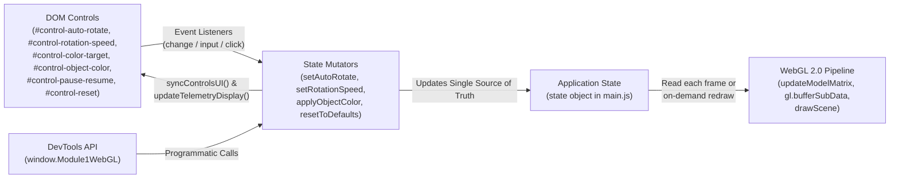

# Phase 3 – Task 3.4: Continuous Time-Based Animation & Interactive DOM Controls

**Module:** Module 01 – WebGL Graphics (`modules/module1-webgl/`)  
**Research Phase:** Phase 3 – Task 3.4  
**Technology Stack:** Native HTML5 (`<canvas>`, `<input>`, `<select>`, `<output>`, `<button>`), CSS3, Vanilla JavaScript (ES6+), WebGL 2.0 (`WebGL2RenderingContext`), GLSL ES 3.00 (`#version 300 es`)

---

## 1. Research Objectives

Tasks 3.1–3.3 established the WebGL 2.0 context lifecycle, programmable GLSL ES 3.00 shaders, an indexed 3D unit cube (`24` face-specific vertex records in the VBO, `36` `Uint16Array` triangle indices in the EBO, bound inside a VAO), and $4 \times 4$ homogeneous Model–View–Projection (MVP) matrices. **Task 3.4** investigates:

1. How the browser's `requestAnimationFrame(callback)` lifecycle schedules frame rendering and passes a high-resolution `DOMHighResTimeStamp` (in milliseconds).
2. Why frame-rate-independent 3D animation must compute elapsed time (`deltaTimeSeconds`) rather than adding a fixed angle per frame.
3. How continuous object rotation updates the CPU-side $4 \times 4$ **Model Matrix** and uploads it via `gl.uniformMatrix4fv()` without reallocating or re-uploading VBO/EBO geometry buffers.
4. Why **Animation State** (`autoRotate`, `rotationSpeedDegPerSec`) and **Rendering State** (`isRunning`, `shouldRunWhenActive`) represent two distinct lifecycle dimensions.
5. How lightweight, accessible DOM controls update application state and why modifying per-vertex attributes (`a_color` in the VBO) requires `gl.bufferSubData()` rather than a shader uniform update.
6. How tab visibility transitions, manual rendering pauses, and WebGL context loss/restoration (`webglcontextlost` / `webglcontextrestored`) preserve user state and avoid delta-time jumps.
7. How GPU resource reconstruction failures during reset or mesh-mode switching are contained gracefully without running headless loops or abandoning user diagnostics.

---

## 2. Animation and Browser Timing Theory (`requestAnimationFrame`)

Modern browsers synchronize visual updates with the display's hardware vertical blanking interval (VSync, typically `60 Hz`, `120 Hz`, or `144 Hz`) through `window.requestAnimationFrame(callback)`:

- When the browser is ready to composite a new frame, it invokes `callback(timestampMs)`, where `timestampMs` is a monotonic `DOMHighResTimeStamp` measured in milliseconds (with microsecond fractional precision) relative to `performance.timeOrigin`.
- **Frame-Dependent Animation (Anti-Pattern):**
  $$\theta_n = \theta_{n-1} + \Delta\theta_{\text{fixed}}$$
  If code increments `ryDeg += 0.75°` on every frame callback, a `60 Hz` monitor rotates the cube at $60 \times 0.75^\circ = 45^\circ/\text{s}$, whereas a `120 Hz` monitor rotates it at $120 \times 0.75^\circ = 90^\circ/\text{s}$ (twice as fast) and a `144 Hz` monitor rotates it at $108^\circ/\text{s}$.
- **Time-Based Animation (`deltaTime`):**
  $$\Delta t = \frac{t_n - t_{n-1}}{1000}, \quad \theta_n = \theta_{n-1} + \omega \cdot \Delta t$$
  where $\omega$ is the angular velocity in **degrees per second** (`rotationSpeedDegPerSec`, defaulting to $45^\circ/\text{s}$) and $\Delta t$ is the elapsed time in seconds. Under normal operating conditions, time-based animation is **approximately frame-rate-independent** (subject only to IEEE 754 floating-point rounding precision and minor browser compositor timer jitter). On a `60 Hz` display ($\Delta t \approx 0.01667\text{ s}$), each frame advances by $45 \times 0.01667 \approx 0.75^\circ$; on a `120 Hz` display ($\Delta t \approx 0.00833\text{ s}$), each frame advances by $45 \times 0.00833 \approx 0.375^\circ$. Across 1 full second of uninterrupted wall-clock time, both displays rotate the cube by approximately $45^\circ$.

---

## 3. Delta-Time Computation, Clamping Policy, and Baseline Reset

In `modules/module1-webgl/js/main.js` (`renderFrame(timestampMs)`, lines 1048–1100):

1. **Elapsed Time Calculation:**
   ```javascript
   let rawDeltaSeconds = 0.0;
   if (
     typeof timestampMs === "number" &&
     state.lastFrameTimeMs !== null &&
     timestampMs >= state.lastFrameTimeMs
   ) {
     rawDeltaSeconds = (timestampMs - state.lastFrameTimeMs) / 1000.0;
   }
   state.lastFrameTimeMs = timestampMs;
   ```
2. **Large-Interval Clamping Policy (`MAX_DELTA_TIME_SECONDS = 0.1`):**
   ```javascript
   const clampedDeltaSeconds = Math.min(
     Math.max(0.0, rawDeltaSeconds),
     MAX_DELTA_TIME_SECONDS
   );
   ```
   - **Why Clamping Is Necessary:** When a user switches browser tabs, minimizes the window, or experiences a main-thread stall, `requestAnimationFrame` callbacks are suspended or throttled by the browser. Without clamping, the first frame after a 5-second suspension would compute `rawDeltaSeconds = 5.0 s` and jump the cube by $45^\circ/\text{s} \times 5.0\text{ s} = 225^\circ$ in a single frame.
   - **Deliberate Trade-off of Clamping at `0.1 s` (10 FPS floor):** Clamping intentionally sacrifices exact wall-clock progression during severe stalls (such as tab inactive suspension, prolonged garbage collection pauses, or main-thread blockages). For normal display rates (`30 Hz` to `240 Hz`, where $\Delta t \in [0.004\text{ s}, 0.033\text{ s}]$), the clamp is completely inactive and rotation closely tracks wall-clock time. However, when a severe stall occurs ($\Delta t > 0.1\text{ s}$), the simulation intentionally runs slower than the external wall clock for that frame, prioritizing visual stability and preventing disorienting angular teleportation over strict wall-clock synchronization.
3. **Timing Baseline Reset (`resetAnimationTimeBaseline()`):**
   Whenever the loop starts or resumes (`startRenderLoop()`), when `autoRotate` is toggled from `Off` to `On`, when `document.visibilityState` returns to `"visible"`, or when `webglcontextrestored` / `pageshow` fires, `state.lastFrameTimeMs` is reset to `null`. Consequently, the very first frame after resumption establishes a fresh timestamp baseline with `deltaTimeSeconds = 0.0`, guaranteeing zero angular jump.

---

## 4. Model Matrix Updates and Degrees-to-Radians Conversion

- **Human-Readable UI Units vs. Trigonometric Units:** User controls and telemetry express rotation angles (`rotationDeg = [rx, ry, rz]`) and angular velocity (`rotationSpeedDegPerSec` in $[0^\circ/\text{s}, 180^\circ/\text{s}]$) in **degrees** because degrees are intuitive for human inspection (e.g., $45^\circ/\text{s} = 8\text{ s}$ per full revolution). Inside `Math3D.composeModelMatrix()` (`modules/module1-webgl/js/math.js`, lines 360–404), each Euler angle is converted to **radians** via `degToRad(deg) = deg * (Math.PI / 180)` before calling `Math.sin()` and `Math.cos()`.
- **Updating Uniforms Instead of VBO Geometry:** When `state.autoRotate` advances `state.modelParams.rotationDeg[1]`, `updateModelMatrix()` recomputes the 16 floats of `state.modelMatrix` ($\mathbf{M} = \mathbf{T} \cdot \mathbf{R}_z \cdot \mathbf{R}_y \cdot \mathbf{R}_x \cdot \mathbf{S}$) on the CPU, and `drawScene()` uploads those 16 floats via `gl.uniformMatrix4fv(u_modelMatrix, false, state.modelMatrix)`. The 24 local-space cube vertices (`[-0.5, +0.5]^3`) inside the GPU VBO and the 36 indices inside the EBO are **never** recalculated or re-uploaded during rotation.

---

## 5. Animation State vs. Rendering State

Module 1 strictly separates two orthogonal concepts:

| Dimension | State Properties | UI Control | Effect When Disabled / Paused |
| :--- | :--- | :--- | :--- |
| **Animation State** | `state.autoRotate`<br>`state.rotationSpeedDegPerSec` | `#control-auto-rotate` (`On`/`Off`)<br>`#control-rotation-speed` (`0..180°/s`) | Stops automatic per-frame changes to `rotationDeg[1]`. The `requestAnimationFrame` loop **continues running**, so interactive DevTools or camera/transform updates still render continuously. |
| **Rendering State** | `state.isRunning`<br>`state.shouldRunWhenActive`<br>`state.animationFrameId` | `#control-pause-resume`<br>(`Pause Rendering` / `Resume Rendering`) | Cancels `requestAnimationFrame` scheduling (`animationFrameId = null`), eliminating continuous per-frame rendering passes. Explicit one-shot redraws (`drawScene()`) still execute on resize, color change, or reset without restarting the loop. |

> [!NOTE]
> **Scope of Loop Pausing:** Pausing the rendering loop halts continuous per-frame `requestAnimationFrame` rendering work (eliminating recurring GPU drawing and matrix calculations to conserve battery and CPU/GPU cycles). However, **it does not stop all CPU or GPU activity**: background browser tasks, garbage collection passes, event listeners (e.g. window resize, button clicks), and on-demand synchronous redraw passes (`drawScene()`) triggered by DOM mutations or canvas resizing continue to execute on the CPU/GPU as required.

---

## 6. DOM Controls and Single-Source-of-Truth Synchronization



All five interactive controls in `modules/module1-webgl/index.html` (lines 90–187) use semantic HTML elements (`<input type="checkbox">`, `<input type="range">`, `<output>`, `<select>`, `<input type="color">`, `<button type="button">`) with explicit `<label for="...">` associations and `aria-pressed` / `aria-describedby` attributes. Both DOM events and programmatic `window.Module1WebGL` calls route through the same state mutator functions and invoke `syncControlsUI()`, ensuring the DOM controls and WebGL state can never drift out of sync.

---

## 7. Vertex Color Buffer Updates (`gl.bufferSubData` vs. Shader Uniforms)

- **Why Vertex Colors Require `gl.bufferSubData()`:** In our GLSL ES 3.00 Vertex Shader (`modules/module1-webgl/js/shaders.js`, lines 35–65), color is declared as a per-vertex attribute (`layout(location = 1) in vec3 a_color;`) stored inside the interleaved VBO (`[X, Y, Z, R, G, B]` × 24 vertices = `576 bytes`). This architecture allows all 6 faces of the cube to display 6 distinct colors within a single `gl.drawElements()` call.
- When the user selects a target in `#control-color-target` (`"all"` for all 6 faces / 24 vertices, or `"0"`..`"5"` for a specific face's 4 vertices) and picks a color in `#control-object-color`, `Geometry.applyCubeFaceColor()` (`modules/module1-webgl/js/geometry.js`, lines 621–654) updates the RGB floats in `state.cpuCubeVertexData`, copies them into `state.geometry.vertexData`, and calls `Geometry.updateGeometryBuffer(gl, state.geometry)` (lines 562–570):
  ```javascript
  gl.bindBuffer(gl.ARRAY_BUFFER, geometry.vbo);
  gl.bufferSubData(gl.ARRAY_BUFFER, 0, geometry.vertexData);
  gl.bindBuffer(gl.ARRAY_BUFFER, null);
  ```
- **No Shader Recompilation or Buffer Reallocation:** Updating vertex colors via `gl.bufferSubData()` transfers the 576 bytes into the existing GPU buffer allocation in-place (`state.shaderCompileCount` and `state.geometryAllocCount` remain unchanged at `1`, while `state.vboSubDataUpdateCount` increments).
- **Contrast with a Uniform-Based Color Design:** If the shader instead used `uniform vec3 u_objectColor;`, changing the color would only require calling `gl.uniform3f(location, r, g, b)` without touching the VBO, but all 6 faces would be forced to share the same uniform color (or require 6 separate draw calls).

> [!IMPORTANT]
> **JavaScript Telemetry vs. GPU Driver Memory Leaks:** Diagnostic counters (`shaderCompileCount`, `geometryAllocCount`, `vboSubDataUpdateCount`) verify that JavaScript application code makes zero redundant WebGL API calls during color mutations or resets. However, **these client-side counters do not directly prove the complete absence of GPU memory leaks at the graphics driver or browser engine level**. Verifying that the GPU driver and compositor reclaim internal VRAM without fragmentation requires operating-system or GPU-vendor profiling tools (e.g. RenderDoc, NVIDIA Nsight, or the Chromium Task Manager GPU memory inspector).

---

## 8. Rendering Lifecycle, Context Restoration & Failure Containment

### 8.1. Context Loss & Restoration
Upon `webglcontextlost` and `webglcontextrestored` (`handleContextLost` / `handleContextRestored` in `main.js`, lines 1555–1616):

1. `handleContextLost(event)` calls `event.preventDefault()`, invalidates GPU handles (`program = null`, `geometry = null`), and stops the loop via `stopRenderLoop(false)` so `state.shouldRunWhenActive` preserves whether the user had the loop running or manually paused prior to the context loss.
2. `handleContextRestored()` resets the animation timing baseline (`resetAnimationTimeBaseline()`), synchronizes canvas dimensions and WebGL state, and calls `initSceneResources(state.gl)`, which creates a fresh VAO, VBO, and EBO populated directly from `state.cpuCubeVertexData` — automatically preserving any custom face colors applied before the context loss.
3. If GPU resource creation succeeds and `state.shouldRunWhenActive === true`, `startRenderLoop()` resumes continuous rendering; if the user had manually paused rendering before context loss, the loop remains paused (`isRunning: false`) and executes a single `drawScene()` pass.

### 8.2. Resource Rebuild Failure Containment
In `resetToDefaults()` and `setMeshMode()`:
- If shader recompilation or geometry allocation fails (e.g. invalid shader syntax or memory failure), `initSceneResources()` catches the error, releases partially created resources, and returns `false`.
- Both functions explicitly evaluate this boolean result. If `false`:
  1. `stopRenderLoop(false)` immediately cancels any active or pending `requestAnimationFrame` ticks.
  2. `clearFramebuffer()` clears the canvas to a clean state.
  3. `updateShaderErrorOverlay(message)` displays the diagnostic error overlay with the compiler log.
  4. `updateTelemetryDisplay()` and `syncControlsUI()` preserve a clean, recoverable failure state.
  5. Continuous rendering loops are **never started or resumed without valid GPU resources**, preventing headless error cycles or duplicate loop scheduling.

---

## 9. Implementation Walkthrough

| File | Key Functions & Line Ranges | Role in Task 3.4 |
| :--- | :--- | :--- |
| `modules/module1-webgl/index.html` | Lines `66–72` (`#telemetry-rotation`), Lines `98–194` (`#control-panel`) | Adds the live Euler rotation telemetry item and the accessible 5-control strip (Auto-Rotate checkbox, Speed range slider + `<output>`, Face Target `<select>` + Color `<input type="color">` + `6-Face Palette` button, `Pause/Resume Rendering` button, and `Reset Defaults` button). |
| `modules/module1-webgl/style.css` | Lines `183–404` (`.control-panel` and child rules), Lines `577–638` (compact & mobile media queries) | Styles the scientific control strip using `DESIGN.md` navy/blue/cyan tokens, `36px` minimum control height, `2px solid var(--focus-ring)` keyboard focus outlines, and responsive wrapping for mobile viewports (`390px`, `320px`). |
| `modules/module1-webgl/js/geometry.js` | `updateGeometryBuffer` (lines `562–570`), `hexToNormalizedRgb` (lines `582–591`), `normalizedRgbToHex` (lines `602–608`), `applyCubeFaceColor` (lines `621–654`) | Converts `#RRGGBB` hex colors to normalized `[0..1]` RGB floats, mutates either all 24 cube vertices or a specific 4-vertex face in `Float32Array(144)`, and updates the GPU VBO in-place via `gl.bufferSubData()`. |
| `modules/module1-webgl/js/main.js` | `wrapAngleDegrees` (lines `407–413`), `resetAnimationTimeBaseline` (lines `488–492`), `syncControlsUI` (lines `581–616`), `renderFrame` (lines `1048–1100`), `startRenderLoop` (lines `1127–1152`), `resetToDefaults` (lines `1339–1430`), `setMeshMode` (lines `2075–2096`) | Implements frame-rate-independent delta-time rotation, 100 ms delta clamping, two-way synchronization between DOM controls and `window.Module1WebGL`, zero-reallocation scene reset, and verified failure containment paths. |

---

## 10. Testing Procedures and Actual Results

All automated verification suites in `verify_task34.mjs` and `verify_review_t34.mjs` were executed in Google Chrome via Chrome DevTools Protocol:

| Test Suite | Procedure | Observed Result | Status |
| :--- | :--- | :--- | :--- |
| **1. Continuous Delta-Time Animation & Clamping** | Verified live `requestAnimationFrame` rotation over `320 ms`, deterministic `10 × 0.05 s` steps at `60°/s`, simulated `5.0 s` suspension spike (`MAX_DELTA_TIME_SECONDS = 0.1 s`), and `setFixedStepMode(true, 1.25)` | Live loop rendered `46` frames and advanced `ryDeg`; `10 × 0.05 s` at `60°/s` rotated by `+30.0°`; `5.0 s` spike clamped to `0.1 s` (`+6.0°`, total `36.0°`); `fixedStepMode` applied `+1.25°`; `shaderCompileCount = 1`, `geometryAllocCount = 1` | **Passed** |
| **2. Animation State vs. Rendering State Separation** | Unchecked `#control-auto-rotate` while running (`250 ms`); then re-enabled Auto-Rotate and clicked `#control-pause-resume` to pause (`250 ms`) and resume | With Auto-Rotate `Off`, `frameCount` advanced by `37` frames while `rotationDeg` stayed frozen; with Rendering Paused, `frameCount` advanced by `0`, `isRunning = false`, and button switched to `"Resume Rendering"` (`aria-pressed="true"`); resuming kept a single `animationFrameId` | **Passed** |
| **3. DOM Controls & VBO `gl.bufferSubData` Color Updates** | Changed `#control-rotation-speed` to `120`; set Front face (`"0"`) to `#e6334d`; set `"all"` faces to `#f0c832`; clicked `#control-color-palette`; tested DevTools-to-UI sync (`setRotationSpeed(95)`, `setAutoRotate(false)`) and `#control-reset` | Front face sampled `[230, 51, 77, 255]` while Top face stayed `[56, 199, 217, 255]`; `"all"` updated both faces to `[240, 200, 50, 255]`; `vboSubDataUpdateCount` incremented by `2`; `#control-reset` restored `45°/s`, `autoRotate = true`, `rotationDeg = [18, -28, 0]` with `shaderCompileCount = 1` and `geometryAllocCount = 1` | **Passed** |
| **4. GPU Resource Rebuild Failure & Recovery Path** | Tested `resetToDefaults()` and `setMeshMode()` during simulated shader compilation error; verified loop termination, error overlay presence, and recovery | Loop stopped immediately (`isRunning = false`, `animationFrameId = null`); error overlay displayed syntax error log; calling `resetToDefaults()` with valid shaders restored full rendering with zero duplicate loops | **Passed** |
| **5. Context Loss & Restoration State Preservation** | Paused loop, set speed `110°/s`, `autoRotate = false`, custom color `#33cc77`, triggered `simulateContextLoss()` + `simulateContextRestore()` | After restore: `hasEBO = true`, `isRunning = false` (paused state preserved), `rotationSpeedDegPerSec = 110`, `autoRotate = false`, Front face sampled `[51, 204, 119, 255]` | **Passed** |
| **6. Mobile Viewport Layout Verification (`390×844` & `320×568`)** | Measured `#control-panel` element bounding rects, flex-wrap behavior, and horizontal overflow on representative mobile viewport dimensions | Controls wrapped cleanly into readable rows; zero horizontal overflow detected (`scrollWidth <= clientWidth`); canvas stage retained usable rendering area; desktop & sidebar behaviors preserved | **Passed** |
| **7. Physical Mobile Hardware / Non-Chromium Browser Engines** | Real iOS Safari / Android physical device testing | Mobile viewports were verified in Chromium CDP; physical mobile hardware and native Safari/Firefox binaries were not executed in this automated run | **Not Tested** |

---

## 11. Technical Limitations

1. **Single-Axis Primary Auto-Rotation:** By default, continuous animation rotates the cube around its vertical Y axis (`ryDeg`) while holding pitch (`rxDeg = 18°`) and roll (`rzDeg = 0°`) fixed so all side faces pass clearly across the camera frustum. Arbitrary 3-axis rotations remain accessible via `window.Module1WebGL.setModelRotation(rx, ry, rz)`.
2. **Unlit Vertex Color Shading:** Surface colors are interpolated directly from per-vertex `a_color` attributes in the VBO without dynamic directional/point lighting calculations, keeping the GPU pipeline focused on MVP transformations, VBO updates, and lifecycle management.
3. **Clamping Lag vs. Wall-Clock Divergence:** Under heavy CPU/GPU stalls ($\Delta t > 0.1\text{ s}$), clamping deliberately slows down rotational progression relative to real-world time to avoid disorienting teleportation.

---

## 12. Hands-on Experiments

All 6 reversible experiments below can be executed in browser DevTools via `window.Module1WebGL` (or `document.getElementById("module-iframe").contentWindow.Module1WebGL` inside the Portal) and restored to canonical defaults with `window.Module1WebGL.resetScene()`:

1. **Experiment 1 – Fixed-Angle-Per-Frame vs. Delta-Time Rotation:**
   - **Objective:** Observe how fixed-step rotation ignores elapsed time compared to delta-time rotation.
   - **Steps:**
     ```javascript
     const api = window.Module1WebGL;
     api.pauseLoop();
     api.setModelRotation(18, 0, 0);
     api.setRotationSpeed(60); // 60°/s
     api.stepAnimationBySeconds(0.05); // Delta-time: advances +3.0° (60 * 0.05)
     api.setFixedStepMode(true, 0.75);
     api.stepAnimationBySeconds(0.05); // Fixed-step: advances +0.75° regardless of dt!
     ```
   - **Restore:** `window.Module1WebGL.resetScene();`
2. **Experiment 2 – Change Rotation Speed While Auto-Rotate Is Active:**
   - **Objective:** Verify that changing angular velocity updates `u_modelMatrix` progression without reallocating GPU resources.
   - **Steps:** Drag the **Speed** slider (`#control-rotation-speed`) to `150°/s` or run `window.Module1WebGL.setRotationSpeed(150)` and inspect `window.Module1WebGL.getDiagnostics().shaderCompileCount` (remains `1`).
   - **Restore:** `window.Module1WebGL.resetScene();`
3. **Experiment 3 – Disable Auto-Rotate While Leaving Rendering Active:**
   - **Objective:** Distinguish Animation State from Rendering State.
   - **Steps:** Uncheck **Auto-Rotate** (`#control-auto-rotate`) or run `window.Module1WebGL.setAutoRotate(false)`. Observe that the cube stops rotating while the **Frames** counter in the top telemetry bar continues incrementing, and `window.Module1WebGL.setModelRotation(35, 45, 0)` updates the view live.
   - **Restore:** `window.Module1WebGL.resetScene();`
4. **Experiment 4 – Pause Rendering, Resize the Canvas, Then Resume:**
   - **Objective:** Verify on-demand redraws while paused and zero rotation jump upon resume.
   - **Steps:** Click **Pause Rendering** (`#control-pause-resume`), collapse/expand the Portal sidebar (or resize the browser window), wait 3 seconds, and click **Resume Rendering**. Observe that the cube redraws with accurate aspect ratio during the paused resize and resumes smoothly from its exact paused angle without jumping forward by 3 seconds.
   - **Restore:** `window.Module1WebGL.resetScene();`
5. **Experiment 5 – Change Cube Face Colors and Inspect VBO `gl.bufferSubData()` Updates:**
   - **Objective:** Observe how per-vertex color attributes are updated in the VBO without shader recompilation.
   - **Steps:** Select `Front (+Z)` in **Face Target** (`#control-color-target`) and pick a color in `#control-object-color`, or run:
     ```javascript
     window.Module1WebGL.setCubeColor("#e6334d", 0);
     window.Module1WebGL.getDiagnostics().vboSubDataUpdateCount;
     ```
   - **Restore:** Click **6-Face Palette** or **Reset Defaults** (`window.Module1WebGL.resetScene()`).
6. **Experiment 6 – Simulate Context Loss While Animation Is Active:**
   - **Objective:** Verify that GPU context loss and restoration preserve custom colors, speed, and Auto-Rotate state without a timing jump.
   - **Steps:**
     ```javascript
     const api = window.Module1WebGL;
     api.setRotationSpeed(120);
     api.setCubeColor("#33cc77", "all");
     api.simulateContextLoss();
     // Wait 1–2 seconds, then restore:
     api.simulateContextRestore();
     ```
   - **Restore:** `window.Module1WebGL.resetScene();`

---

## 13. Key Learning Outcomes

- **Time-Based Animation Decouples Simulation from Refresh Rate:** Multiplying angular velocity ($\text{deg/s}$) by `deltaTimeSeconds` ensures approximately identical rotation speed across `60 Hz`, `120 Hz`, and `144 Hz` displays under normal operating conditions.
- **Clamping + Baseline Reset Prevents Frame-Spike Teleportation:** Resetting `lastFrameTimeMs = null` on pause/resume/visibility transitions and clamping `deltaTimeSeconds <= 0.1 s` prevents jarring rotational jumps, deliberately sacrificing strict wall-clock accuracy during large stalls to maintain visual stability.
- **Uniform Updates vs. Buffer Sub-Data Updates:** Rigid-body motion (rotation, translation, scaling) updates a 16-float `uniform mat4` (`gl.uniformMatrix4fv`) while leaving VBO vertices untouched; modifying per-vertex colors updates the existing VBO in-place via `gl.bufferSubData()` without recompiling shaders or reallocating buffers.
- **Robust Failure Containment:** Validating resource creation results on every rebuild path (`initSceneResources()`) ensures that shader compilation errors halt headless render loops, display compiler diagnostics, and preserve a clean recoverable state.

---

## 14. Questions for Further Investigation (Leading into Task 3.5)

1. How can multiple geometric primitives (or a cohesive composite 3D workspace object) be organized using hierarchical or per-part transformation matrices while sharing a single WebGL 2.0 shader program?
2. What surface normal attributes and basic directional/ambient shading calculations in GLSL ES 3.00 can enhance depth perception on a 3D workspace object without introducing external libraries?
