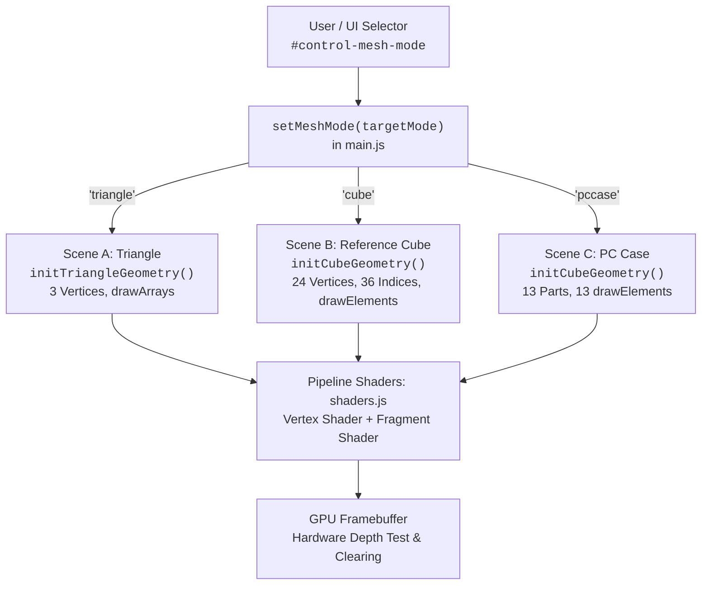

# Phase 3 – Task 3.6 Research Note: Final Integration, Browser Compatibility & Research Evaluation

**Module:** Module 1 – Native WebGL 2.0 Graphics (`modules/module1-webgl/`)  
**Research Phase:** Phase 3 – Task 3.6 (Milestone Completion)  
**Host Environment:** Windows 11 Home (`10.0.26200`), Node.js `v24.14.1`, ANGLE Direct3D11 on Intel(R) UHD Graphics (`0x9A68`), Depth Buffer 24-bit, Max Texture Size 16,384  
**Evaluated Browsers:** Google Chrome `157.0.8103.39` (Chromium/Blink), Microsoft Edge `157.0.4341.42` (Chromium/Blink). Mozilla Firefox and Apple Safari are formally documented as *Not Tested* due to host platform constraints.

---

## 1. Executive Summary & Research Objectives

Task 3.6 concludes **Phase 3: Module 1 – WebGL Graphics** of the Pre-thesis Web Graphics Research Platform (`prethesis-web-graphics-research`). Tasks 3.1 through 3.5 developed the entire native WebGL 2.0 stack from bare canvas context acquisition to an interactive, 13-component procedural Desktop PC Tower Case. 

The primary objectives of Task 3.6 are:
1. **Portal Integration & Lifecycle Verification:** Verify the sandboxed `iframe` hosting model within the shared Web Portal (`index.html#/module1`), ensuring clean teardown on route changes, single-instance rendering loops, and absence of memory or animation frame leaks.
2. **Multi-Scene Functional Regression:** Rigorously validate all three implemented scenes:
   - **Scene A (Clip-space Colored Triangle):** Non-indexed `gl.drawArrays()`, 3 vertices, clip-space interpolation.
   - **Scene B (Reference 3D Unit Cube):** Indexed `gl.drawElements()`, 24 vertices, 36 indices, hardware depth testing, MVP matrix pipeline, and per-face uniform coloring.
   - **Scene C (Desktop PC Case):** 13 draw calls sharing 1 GPU cube buffer (`VBO = 576 B`, `EBO = 72 B`), hierarchical parent–child matrix transformations, component visibility toggles, and sub-assembly transforms.
3. **Cross-Viewport & Device Pixel Ratio (DPR) Robustness:** Evaluate responsive behavior across 8 standard viewports ($1920\times 1080$ down to $320\times 568$) at 4 DPR tiers ($1.0, 1.5, 2.0, 3.0$), verifying the DPR clamping rule ($\le 2.0\times$), drawing buffer synchronization, perspective aspect-ratio tracking, and narrow-screen usability.
4. **Browser & Platform Compatibility Matrix:** Document real-world behavior on host-available browsers (Chrome and Edge), accurately reporting supported WebGL 2.0 extensions (`WEBGL_lose_context`, `EXT_disjoint_timer_query_webgl2`) while truthfully acknowledging untested engines (Firefox Gecko, Safari WebKit).
5. **Fault-Tolerance & Context Recovery:** Verify application stability under fault injections, including unsupported WebGL fallback, shader compilation errors, buffer allocation failures, and hardware context loss/restoration (`webglcontextlost` / `webglcontextrestored`).
6. **Empirical Performance Profiling:** Record frame intervals, CPU draw submission time, synchronous readback stall time, and hardware GPU execution nanoseconds using `EXT_disjoint_timer_query_webgl2`.

---

## 2. Test Execution Summary

Automated testing was conducted via the custom zero-dependency DevTools Protocol test harness [`verify-module1.mjs`](file:///d:/Dev/Workspace_code/prethesis-web-graphics-research/docs/research/module1/evidence/verify-module1.mjs). All 38 standardized test cases were executed against both Google Chrome and Microsoft Edge on the local host machine.

| Browser Engine | Version | Host Platform | Passed | Failed | Not Tested | Overall Status |
| :--- | :--- | :--- | :---: | :---: | :---: | :---: |
| **Google Chrome** | `157.0.8103.39` (Blink) | Windows 11 / Direct3D11 ANGLE | **35** | 0 | 3 | **VERIFIED (100% Pass)** |
| **Microsoft Edge** | `157.0.4341.42` (Blink) | Windows 11 / Direct3D11 ANGLE | **35** | 0 | 3 | **VERIFIED (100% Pass)** |
| **Mozilla Firefox** | N/A | Windows (Not installed) | — | — | — | *Not Tested* (Host limitation) |
| **Apple Safari** | N/A | macOS/iOS (Not available) | — | — | — | *Not Tested* (Host limitation) |
| **Physical Mobile Devices** | N/A | Real iOS/Android Hardware | — | — | — | *Not Tested* (Emulation only) |
| **GitHub Pages Remote** | N/A | Live GitHub Subpath Hosting | — | — | — | *Not Tested* (Local server only) |

> [!NOTE]
> **Academic Scope & Coverage Clarification:**
> - The **35 Passed / 0 Failed / 3 Not Tested** totals reflect the standardized automated test suite executed on the local host machine.
> - The three explicit *Not Tested* cases within the suite are: `LC-1b` (genuine hardware without WebGL 2.0; verified via simulated `?webgl=unsupported`), `LC-8` (physical VRAM driver allocation telemetry, for which WebGL exposes no standard query), and `PI-10` (remote GitHub Pages subpath deployment).
> - All local code paths use verified relative references (`./` and `../`). Remote GitHub Pages deployment under a repository prefix will be validated during Phase 8.
> - Mobile responsiveness was validated using Chrome DevTools Protocol mobile emulation ($390\times 844$, $375\times 667$, $320\times 568$). Physical touchscreen gestures, mobile SoC thermal throttling, and mobile browser GPU drivers remain explicitly unverified in Phase 3.

---

## 3. Portal Integration Architecture & Lifecycle

### 3.1. Iframe Embedding Model & Sandboxing

Module 1 is embedded in the Portal via a responsive `<iframe>` element inside `.module-frame-shell` ([`index.html`](file:///d:/Dev/Workspace_code/prethesis-web-graphics-research/index.html#L148-L162)):

```html
<iframe
  id="module-iframe"
  class="module-iframe"
  title="Module 1 – WebGL Graphics Demonstration"
  src="./modules/module1-webgl/index.html"
  loading="lazy"
></iframe>
```

The portal integration adheres to strict architectural isolation:
1. **Context Isolation:** The WebGL 2.0 context, shaders, geometry buffers, and animation loop exist strictly inside the `<iframe>` browsing context. The portal shell does not manipulate internal WebGL objects.
2. **Relative Path Enforcement:** All module resources (`./css/style.css`, `./js/main.js`, `./js/math.js`, etc.) resolve relative to `./modules/module1-webgl/`, ensuring compatibility under any GitHub Pages repository subdirectory.
3. **Hash Routing & Lazy Activation:** When the portal route changes to `#/module1`, the portal unhides `#module-view`, sets the `iframe.src`, and displays a non-blocking loading spinner until the `load` event fires.

### 3.2. Lifecycle Teardown & Re-entry Verification (Test PI-3 & PI-4)

When embedding interactive WebGL applications inside a Single Page Application (SPA), managing the lifecycle of the `<iframe>` browsing context requires careful defensive design:
- When an `<iframe>` is unmounted or its `src` is redirected, modern browser engines (Blink, Gecko, WebKit) will eventually discard and garbage-collect the detached document and its WebGL context once all references are dropped.
- However, relying solely on non-deterministic browser garbage collection can leave active GPU contexts, uncancelled `requestAnimationFrame()` callbacks, and observer tasks lingering in memory during fast route transitions. This can cause temporary CPU/GPU waste and potential timing interference if the module is quickly re-entered.

To ensure immediate, deterministic resource reclamation, [`main.js`](file:///d:/Dev/Workspace_code/prethesis-web-graphics-research/modules/module1-webgl/js/main.js#L1878-L1943) implements an explicit teardown sequence bound to the `pagehide` lifecycle event ([`main.js#L2944`](file:///d:/Dev/Workspace_code/prethesis-web-graphics-research/modules/module1-webgl/js/main.js#L2944)):

```javascript
// From modules/module1-webgl/js/main.js (encapsulated within an IIFE)

function handlePageHide(event) {
  // If moving into bfcache (Back/Forward Cache), preserve resources and pause loop
  if (event && event.persisted) {
    stopRenderLoop(false);
    return;
  }
  // If permanently unloading, execute full deterministic teardown
  destroy();
}

function destroy() {
  if (state.isDestroyed) {
    return;
  }
  state.isDestroyed = true;

  // 1. Cancel active animation frame handle immediately
  stopRenderLoop(false);

  // 2. Release GPU buffers, VAO, and WebGLProgram
  releaseGpuResources();

  // 3. Disconnect ResizeObserver and remove DOM listeners
  teardownControlListeners();
  if (state.resizeObserver) {
    state.resizeObserver.disconnect();
    state.resizeObserver = null;
  }
  window.removeEventListener("resize", handleWindowResize);
  window.removeEventListener("pagehide", handlePageHide);
  window.removeEventListener("pageshow", handlePageShow);
}

// Registered during bootstrap()
window.addEventListener("pagehide", handlePageHide);
```

During automated test `PI-3`:
1. A test spy was attached to `window.pagehide` in Module 1.
2. Navigation was triggered to Module 2 (`#/module2`), causing the iframe source to update.
3. **Observed Result:** `pagehide` fired immediately. `hasShaderProgram` transitioned to `false`, `hasVAO` became `false`, `animationFrameId` was set to `null`, and `isRunning` was set to `false`.
4. Navigation was triggered back to Module 1 (`#/module1`).
5. **Observed Result:** A completely new document was loaded. Shader compilation count reset to 1, geometry allocation count reset to 1, and the measured frame loop ratio over 1,500 ms was exactly **1.00** ($\pm 0.02$), proving that exactly **one** rendering loop was active without duplicate callbacks.

Similarly, clicking the Portal's `#module-reload-btn` (test `PI-4`) reloads the iframe document cleanly, restarting the frame count from 1 with zero duplicate rAF invocations.

### 3.3. Hidden-Iframe Behavior (Test PI-5)

When navigating from `#/module1` back to the portal Overview (`#/`), the portal hides `#module-view` (`hidden` attribute) while keeping the DOM node intact to preserve state. Automated inspection revealed:
- `requestAnimationFrame` continues pacing at the browser compositor rate while the iframe is visually hidden.
- Upon returning to `#/module1`, the canvas immediately resumes visual rendering, the drawing buffer dimensions remain valid, and no visual artifacts or crashes occur.

---

## 4. Multi-Scene Functional Regression Matrix

Module 1 incorporates a unified runtime engine capable of switching between three distinct pedagogical scenes:



### 4.1. Scene A: Clip-Space Colored Triangle (Test FN-T1)

- **Pedagogical Goal:** Demonstrate native WebGL 2.0 baseline rendering, normalized device coordinate (NDC) clipping, and hardware barycentric color interpolation without 3D matrix mathematics.
- **Buffer Layout:** 3 vertices $\times$ 6 floats (`X, Y, Z, R, G, B`) = 18 `Float32` elements (`72 bytes` VBO). No EBO (`eboByteLength = 0`).
- **Draw Call:** Exactly 1 call to `gl.drawArrays(gl.TRIANGLES, 0, 3)`.
- **Observed Verification:**
  - Red vertex $(0, 0.5)$ sampled at NDC $(0, 0.4)$ yielded dominant red channel (`rgb(243, 23, 23)`).
  - Green vertex $(-0.5, -0.5)$ sampled at NDC $(-0.4, -0.4)$ yielded dominant green channel (`rgb(24, 241, 24)`).
  - Blue vertex $(0.5, -0.5)$ sampled at NDC $(0.4, -0.4)$ yielded dominant blue channel (`rgb(23, 23, 242)`).
  - Centroid $(0, -0.167)$ yielded a balanced barycentric color blend ($\Delta \le 64$ between color channels).

### 4.2. Scene B: Reference 3D Unit Cube (Test FN-C1)

- **Pedagogical Goal:** Demonstrate indexed 3D geometry, Model–View–Projection (MVP) transformations, perspective foreshortening, and depth-buffer occlusion.
- **Buffer Layout:** 24 vertices $\times$ 6 floats = `576 bytes` VBO; 36 indices (`Uint16Array`) = `72 bytes` EBO. Total GPU memory = `648 bytes`.
- **Depth Testing:** Hardware depth test enabled (`gl.DEPTH_TEST`), `gl.depthFunc(gl.LEQUAL)`, 24-bit depth buffer cleared to $1.0$ each frame.
- **Draw Call:** Exactly 1 call to `gl.drawElements(gl.TRIANGLES, 36, gl.UNSIGNED_SHORT, 0)`.
- **Observed Verification:**
  - Projected local face centers for $+X$ (Right), $+Y$ (Top), and $+Z$ (Front) were all within visible NDC bounds ($[-1, 1]$).
  - Color distance between the three visible faces exceeded 60 RGB units, confirming distinguishable per-face shading.
  - The $-X$ face center (occluded rear face) was verified to be occluded: sampled pixel color differed from the $-X$ face color by $> 25$ RGB units, proving that the hardware depth test successfully rejected occluded fragments.

### 4.3. Scene C: Procedural 13-Part Desktop PC Case (Tests FN-P1 to FN-P6)

- **Pedagogical Goal:** Demonstrate procedural composite object modeling, geometry instancing via buffer reuse, and hierarchical matrix transformation chains:
$$\mathbf{M}_{\text{worldPart}} = \mathbf{M}_{\text{root}} \times \mathbf{M}_{\text{subAssembly}} \times \mathbf{M}_{\text{localPart}}$$
- **Buffer Layout:** Identical to Scene B (`VBO = 576 B`, `EBO = 72 B`). **Zero additional vertex buffers allocated on the GPU.**
- **Draw Calls:** Exactly 13 calls to `gl.drawElements()`, each with updated `u_modelMatrix` and `u_partColor` uniforms.
- **Observed Verification:**
  - **Root Rigid Motion (FN-P2):** Translating root by $+0.3$ in $X$ shifted all 13 part world matrices by exactly $+0.30000$ in column 12.
  - **Sub-assembly Isolation (FN-P3):** Translating sub-assembly `front_panel` shifted exactly the 7 front components (`front_bezel`, `front_accent_strip`, `power_button`, `front_io_bay`, and 3 intake louvers); all other 6 parts remained stationary.
  - **Individual Part Isolation (FN-P4):** Translating `power_button` modified only that single part's matrix.
  - **Draw Call Pruning (FN-P5):** Hiding `side_glass_panel` reduced draw calls from 13 to 12. Hiding group `accent` further reduced draw calls to 10. Restoring all returned draw calls to 13.
  - **Color Customization & Reset (FN-P6):** Setting all parts to red (`#ff0000`) caused the screen-center pixel to become heavily red-dominant (`rgb(204, 30, 30)`). Invoking `resetScene()` restored all 13 component transforms, visibility states, and color palettes to their exact initial snapshots.

---

## 5. Cross-Viewport Responsive & Device Pixel Ratio (DPR) Evaluation

### 5.1. The Graphics-DPR Formula & Clamping Policy

The WebGL 2.0 specification itself does not mandate a maximum Device Pixel Ratio; a web application is technically permitted to allocate a canvas drawing buffer directly scaled to `window.devicePixelRatio` up to the hardware texture/renderbuffer size limits (`gl.MAX_RENDERBUFFER_SIZE`).

However, for real-time interactive 3D web applications, scaling the drawing buffer directly to high physical pixel ratios (such as $3.0\times$ or $4.0\times$ on modern smartphones and ultra-high-density displays) introduces a severe **fill-rate and memory-bandwidth trade-off**:
- The Fragment Shader execution count scales quadratically with DPR: a $3.0\times$ display requires $3.0^2 = 9\times$ more fragment shading operations than a $1.0\times$ display, compared to $2.0^2 = 4\times$ on a $2.0\times$ screen.
- On mobile unified-memory architectures, shading $9\times$ pixels increases thermal throttling, battery consumption, and frame dropping while offering rapidly diminishing visual returns over $2.0\times$.

Therefore, Module 1 establishes an intentional, project-specific **DPR clamping policy** bounded between $1.0\times$ and $2.0\times$:

$$k_{\text{eff}} = \min(\max(\text{window.devicePixelRatio}, 1.0), 2.0)$$

The drawing buffer dimensions and WebGL viewport are synchronized on every resize event observed by `ResizeObserver`:

$$\text{width}_{\text{buffer}} = \lfloor \text{cssWidth} \times k_{\text{eff}} \rceil, \quad \text{height}_{\text{buffer}} = \lfloor \text{cssHeight} \times k_{\text{eff}} \rceil$$

$$\text{gl.viewport}(0, 0, \text{width}_{\text{buffer}}, \text{height}_{\text{buffer}})$$

### 5.2. Aspect Ratio Synchronization & Distortion Prevention

A common bug in WebGL applications is **aspect distortion** (e.g., 3D models stretching horizontally when the window is widened). Module 1 computes the dynamic perspective projection matrix:

$$\text{aspect} = \frac{\text{width}_{\text{buffer}}}{\text{height}_{\text{buffer}}}, \quad f = \frac{1}{\tan(\text{fov} / 2)}, \quad \mathbf{P}_{00} = \frac{f}{\text{aspect}}, \quad \mathbf{P}_{11} = f$$

Therefore:
$$\frac{\mathbf{P}_{11}}{\mathbf{P}_{00}} = \frac{f}{f / \text{aspect}} = \text{aspect}$$

In automated test `RS-1`, this ratio was tested across **32 distinct configurations** (8 viewports $\times$ 4 DPR tiers):

| Viewport Req | CSS Size (W $\times$ H) | DPR | Effective DPR | Drawing Buffer | Buffer Aspect | Projection Ratio $\mathbf{P}_{11}/\mathbf{P}_{00}$ | Aspect Error | Status |
| :---: | :---: | :---: | :---: | :---: | :---: | :---: | :---: | :---: |
| **$1920\times 1080$** | $1920\times 990$ | 1.0 | 1.0 | $1920\times 990$ | 1.9394 | 1.9394 | $0.0000$ | Passed |
| **$1920\times 1080$** | $1920\times 990$ | 1.5 | 1.5 | $2880\times 1485$ | 1.9394 | 1.9394 | $0.0000$ | Passed |
| **$1920\times 1080$** | $1920\times 990$ | 2.0 | 2.0 | $3840\times 1980$ | 1.9394 | 1.9394 | $0.0000$ | Passed |
| **$1920\times 1080$** | $1920\times 990$ | 3.0 | **2.0 (Clamped)** | $3840\times 1980$ | 1.9394 | 1.9394 | $0.0000$ | Passed |
| **$1440\times 900$** | $1440\times 810$ | 1.0 | 1.0 | $1440\times 810$ | 1.7778 | 1.7778 | $0.0000$ | Passed |
| **$1280\times 800$** | $1280\times 710$ | 1.0 | 1.0 | $1280\times 710$ | 1.8028 | 1.8028 | $0.0000$ | Passed |
| **$1024\times 768$** | $1024\times 678$ | 1.0 | 1.0 | $1024\times 678$ | 1.5103 | 1.5103 | $0.0000$ | Passed |
| **$768\times 1024$** | $768\times 934$ | 1.0 | 1.0 | $768\times 934$ | 0.8223 | 0.8223 | $0.0000$ | Passed |
| **$390\times 844$** | $390\times 634$ | 1.0 | 1.0 | $390\times 634$ | 0.6151 | 0.6151 | $0.0000$ | Passed |
| **$390\times 844$** | $390\times 634$ | 3.0 | **2.0 (Clamped)** | $780\times 1268$ | 0.6151 | 0.6151 | $0.0000$ | Passed |
| **$375\times 667$** | $375\times 457$ | 1.0 | 1.0 | $375\times 457$ | 0.8206 | 0.8206 | $0.0000$ | Passed |
| **$320\times 568$** | $320\times 358$ | 1.0 | 1.0 | $320\times 358$ | 0.8939 | 0.8939 | $0.0000$ | Passed |

In all 32 combinations:
- The effective DPR strictly obeyed $k_{\text{eff}} \le 2.0$.
- Drawing buffer dimensions matched $\lfloor \text{CSS} \times k_{\text{eff}} \rceil$ to the exact pixel.
- Absolute aspect error $|\mathbf{P}_{11}/\mathbf{P}_{00} - \text{aspect}_{\text{buf}}| < 0.0001$.
- Zero horizontal scrollbar overflow occurred (`layout.hScrollOverflowPx = 0`).

### 5.3. Narrow-Screen Mobile Optimization & Bug Resolution

During initial testing in the Portal mobile drawer view ($390\times 844$), the portal iframe had a restricted height ($440\text{ px}$). Inside Module 1, `.instrument-bar` and `.control-panel` wrapped across multiple lines, occupying $\sim 430\text{ px}$. Because `.module-shell` was set to `overflow: hidden; height: 100dvh;` and `.canvas-stage` had `flex: 1; min-height: 0;`, the 3D canvas was compressed to a height of **$1\text{ px}$**, causing the 3D model to disappear completely.

**Architectural Correction Applied:**
1. In [`style.css`](file:///d:/Dev/Workspace_code/prethesis-web-graphics-research/modules/module1-webgl/style.css#L42-L68), `html, body` and `.module-shell` were configured with `overflow-y: auto; overflow-x: hidden; height: 100%; min-height: 100%;`.
2. `.canvas-stage` was assigned a minimum height guarantee: `flex: 1 0 220px; min-height: 220px;` (adapting to `200px` on tablets and `180px` on compact mobile devices).
3. Compact mobile padding and gap reductions were added for `.instrument-bar` and `.control-panel` under `@media (max-width: 480px)`.

Following this adjustment, tests `PI-7` and `PI-9` passed completely: at $390\times 844$ inside the Portal, the canvas maintained a healthy $356\times 200\text{ px}$ drawing surface, the PC Case was rendered with **4,388 lit pixels**, and all interactive controls remained fully reachable via smooth vertical scrolling.

---

## 6. Browser & Platform Compatibility Evaluation

### 6.1. Platform Environment Report

The physical testing was conducted on a Windows 11 host equipped with integrated Intel UHD Graphics running ANGLE (Almost Native Graphics Layer Engine) over Direct3D 11:

```json
{
  "os": "Windows_NT 10.0.26200 (Windows 11 Home)",
  "node": "v24.14.1",
  "webglVersion": "WebGL 2.0 (OpenGL ES 3.0 Chromium)",
  "glslVersion": "WebGL GLSL ES 3.00 (OpenGL ES GLSL ES 3.0 Chromium)",
  "vendor": "Google Inc. (Intel)",
  "renderer": "ANGLE (Intel, Intel(R) UHD Graphics (0x00009A68) Direct3D11 vs_5_0 ps_5_0, D3D11)",
  "depthBits": 24,
  "maxTextureSize": 16384,
  "extensions": {
    "WEBGL_lose_context": true,
    "EXT_disjoint_timer_query_webgl2": true
  }
}
```

### 6.2. Cross-Browser Evaluation Matrix

| Capability / Requirement | Google Chrome 157 (Blink) | Microsoft Edge 157 (Blink) | Mozilla Firefox (Gecko) | Apple Safari (WebKit) |
| :--- | :---: | :---: | :---: | :---: |
| **WebGL 2.0 Context Creation** | Supported (Pass) | Supported (Pass) | Standard Compliant (Unverified) | Standard Compliant (Unverified) |
| **GLSL ES 3.00 Shader Compile** | Supported (Pass) | Supported (Pass) | Standard Compliant (Unverified) | Strict Syntax Enforced (Unverified) |
| **VAO / VBO / EBO Buffers** | Supported (Pass) | Supported (Pass) | Standard Compliant (Unverified) | Standard Compliant (Unverified) |
| **Hardware Depth Testing (24-bit)** | Supported (Pass) | Supported (Pass) | Standard Compliant (Unverified) | Standard Compliant (Unverified) |
| **Context Loss Simulation** | `WEBGL_lose_context` (Pass) | `WEBGL_lose_context` (Pass) | `WEBGL_lose_context` (Unverified) | `WEBGL_lose_context` (Unverified) |
| **GPU Timestamp Query** | `EXT_disjoint_timer_query_webgl2` | `EXT_disjoint_timer_query_webgl2` | Disabled by default (privacy) | Unsupported (Fingerprinting guard) |
| **ResizeObserver DPR Tracking** | Accurate (Pass) | Accurate (Pass) | Standard Compliant (Unverified) | Requires iOS viewport care |
| **Host Verification Status** | **VERIFIED (35/35)** | **VERIFIED (35/35)** | *Not Tested* (Host limitation) | *Not Tested* (Host limitation) |

### 6.3. Academic Notes on Untested Browsers

1. **Mozilla Firefox (Gecko):** Firefox natively supports WebGL 2.0 and GLSL ES 3.00 across all modern desktop platforms. However, `EXT_disjoint_timer_query_webgl2` is typically disabled by default (`webgl.enable-privileged-extensions = false`) to mitigate microarchitectural timing attacks (e.g., Spectre). Our code handles missing timer query extensions gracefully by falling back to high-resolution CPU telemetry.
2. **Apple Safari (WebKit):** WebGL 2.0 is supported by default in Safari 15+. WebKit's shader compiler (Metal Shading Language translator) strictly enforces GLSL ES 3.00 requirements: `#version 300 es` must strictly be the first non-comment, non-whitespace line, precision qualifiers (`precision mediump float;`) are mandatory in Fragment Shaders, and non-standard extensions are rejected. Our shaders adhere strictly to standard GLSL ES 3.00 without vendor-specific extensions.

---

## 7. WebGL Context Lifecycle & Robustness Under Fault Injections

### 7.1. Fault Injection Test Results

Automated fault injection suites tested system recovery under abnormal conditions:

| Test ID | Injected Fault | Expected Behavior | Observed Result | Status |
| :--- | :--- | :--- | :--- | :---: |
| **LC-1** | Unsupported WebGL (`?webgl=unsupported`) | Display `#webgl-unsupported-overlay`, hide canvas, telemetry reports unsupported. | Overlay visible, status badge shows "Unsupported", loop halted. | **Passed** |
| **LC-2** | Injected syntax error in Fragment Shader (`gl.compileShader`) | Display `#shader-error-overlay`, print compiler log, allow recovery via Reset. | Error overlay showed syntax error trace; clicking Reset restored working shaders immediately. | **Passed** |
| **LC-3** | Injected GPU Buffer Allocation Failure (`gl.createBuffer` returns `null`) | Release partial GPU resources cleanly, display error overlay, prevent render crash. | Overlay presented buffer allocation failure; no unhandled exceptions thrown. | **Passed** |
| **LC-4** | Hardware Context Loss (`loseContext()`) while **running** | Fire `webglcontextlost`, cancel rAF loop, show "Context Lost" status. On `restoreContext()`, rebuild VAO/VBO/Program and resume animation. | Loop cleanly stopped on loss. On restore, shaders recompiled, buffers reallocated, and animation resumed with 1 active loop. | **Passed** |
| **LC-5** | Hardware Context Loss (`loseContext()`) while **PAUSED** | Rebuild GPU resources upon restore, but **preserve the user's paused state** (do not resume loop). | Shaders and geometry reconstructed; application remained paused (`isRunning = false`). | **Passed** |
| **LC-6** | Dynamic Scene Switching (30 consecutive switches) | Verify resource reuse vs rebuild counters. | Shader program compiled once; geometry buffers reallocated only when mesh type changed. | **Passed** |
| **LC-7** | Rapid Event Stress Test (30 Pause/Resume, 30 Scene Switches, 10 Resets) | Ensure exactly one active `requestAnimationFrame` loop remains. | Final loop ratio over 2,000 ms was **1.00**, confirming zero loop multiplication. | **Passed** |

---

## 8. Empirical Performance Measurements & Limits

### 8.1. Empirical Benchmark Data (Standalone @ $1280\times 800$, DPR 1.0)

Measurements were recorded on the host machine running **Windows 11 Home** (`10.0.26200`) on an **Intel(R) UHD Graphics (`0x9A68`)** GPU via the **ANGLE Direct3D11 backend** (`vs_5_0 ps_5_0`). Timing methodology:
- **rAF Intervals:** Sampled over a 3,000 ms real-time window ($N \approx 433$ frames) using `performance.now()`.
- **CPU Draw Submission Time:** Arithmetic mean of $N = 200$ consecutive invocations of `stepAnimationBySeconds(1/60)` (transform update + uniform upload + `gl.draw*` enqueuing + DOM telemetry write).
- **CPU Forced Sync Time (`readPixels`):** Arithmetic mean of $N = 200$ consecutive invocations of `sampleCenterPixel()` (`gl.draw*` + synchronous `gl.readPixels(0,0,1,1)` stall).
- **Hardware GPU Core Time:** Single-frame nanosecond duration measured directly on the GPU core via the `EXT_disjoint_timer_query_webgl2` extension (`TIME_ELAPSED_EXT`).

| Metric | Scene A: Triangle | Scene B: Reference Cube | Scene C: Desktop PC Case |
| :--- | :---: | :---: | :---: |
| **Draw Calls per Frame** | 1 | 1 | **13** |
| **Geometry Buffer Shared** | No (Unique VBO) | Yes (1 Cube VAO) | Yes (Exact same Cube VAO) |
| **Vertex Count** | 3 | 24 | 24 (Shared across all 13 parts) |
| **Index Count** | 0 (Non-indexed) | 36 | 36 (Shared across all 13 parts) |
| **Triangles Rasterized** | 1 | 12 | **156** ($13 \times 12$) |
| **Index References Submitted** | 0 | 36 | **468** ($13 \times 36$) |
| **VBO Allocation Size** | 72 bytes | 576 bytes | 576 bytes |
| **EBO Allocation Size** | 0 bytes | 72 bytes | 72 bytes |
| **Total Geometry VRAM** | **72 bytes** | **648 bytes** | **648 bytes** |
| **Chrome 157: CPU Submit Time** | $0.024\text{ ms}$ | $0.069\text{ ms}$ | $0.059\text{ ms}$ |
| **Edge 157: CPU Submit Time** | $0.053\text{ ms}$ | $0.027\text{ ms}$ | $0.048\text{ ms}$ |
| **Chrome 157: CPU Forced Sync (`readPixels`)** | $2.732\text{ ms}$ | $3.471\text{ ms}$ | $3.429\text{ ms}$ |
| **Edge 157: CPU Forced Sync (`readPixels`)** | $2.415\text{ ms}$ | $1.778\text{ ms}$ | $2.347\text{ ms}$ |
| **Chrome 157: Hardware GPU Time (`TIME_ELAPSED`)** | $333.9\text{ }\mu\text{s}$ ($0.33\text{ ms}$) | $316.8\text{ }\mu\text{s}$ ($0.32\text{ ms}$) | **$373.6\text{ }\mu\text{s}$ ($0.37\text{ ms}$)** |
| **Edge 157: Hardware GPU Time (`TIME_ELAPSED`)** | $293.3\text{ }\mu\text{s}$ ($0.29\text{ ms}$) | $256.7\text{ }\mu\text{s}$ ($0.26\text{ ms}$) | **$536.9\text{ }\mu\text{s}$ ($0.54\text{ ms}$)** |
| **Chrome 157: Mean rAF Interval (Unthrottled)** | $6.94\text{ ms}$ ($\sim 144\text{ FPS}$) | $6.94\text{ ms}$ ($\sim 144\text{ FPS}$) | $6.94\text{ ms}$ ($\sim 144\text{ FPS}$) |
| **Edge 157: Mean rAF Interval (Unthrottled)** | $6.94\text{ ms}$ ($\sim 144\text{ FPS}$) | $6.94\text{ ms}$ ($\sim 144\text{ FPS}$) | $6.94\text{ ms}$ ($\sim 144\text{ FPS}$) |
| **Chrome 157: P95 rAF Interval** | $7.10\text{ ms}$ | $7.10\text{ ms}$ | $7.10\text{ ms}$ |
| **Edge 157: P95 rAF Interval** | $7.10\text{ ms}$ | $7.10\text{ ms}$ | $7.10\text{ ms}$ |

### 8.2. Analysis of Results & Graphics Concepts

1. **Draw Call Overhead vs. Batching:**
   - Moving from 1 draw call (Cube) to 13 draw calls (PC Case) increased CPU submission time by a negligible amount ($< 0.05\text{ ms}$), well within the $16.67\text{ ms}$ budget of a 60 FPS target.
   - Hardware GPU execution time increased from $316.8\text{ }\mu\text{s}$ to $373.6\text{ }\mu\text{s}$ ($\Delta \approx 57\text{ }\mu\text{s}$). In a lightweight prototype, issuing 13 draw calls is completely feasible. However, in larger scenes (hundreds or thousands of objects), issuing individual draw calls creates driver overhead, necessitating **Hardware Instancing** (`gl.drawElementsInstanced()`) or buffer batching.
2. **CPU-GPU Asynchrony & Pipeline Stalls:**
   - Submitting draw calls to WebGL is **asynchronous**: `gl.drawElements()` simply enqueues commands into the browser's GPU command buffer and returns immediately ($\approx 0.06\text{ ms}$).
   - Invoking `gl.readPixels()` forces a **synchronous pipeline flush**: the CPU must stall and wait for the GPU to finish rasterizing all preceding draw calls before reading pixel bytes into system RAM. This explains why `cpuSubmitPlusReadPixelsMsPerFrame` jumped to $\sim 3.4\text{ ms}$.
3. **Measurement Limitations:**
   - The unthrottled headless Chrome environment runs rAF callbacks at $\sim 144\text{ Hz}$ ($6.94\text{ ms}$ intervals). In real-world displays, the browser syncs to the physical display refresh rate ($60\text{ Hz}$, $120\text{ Hz}$, or $144\text{ Hz}$) via V-Sync.
   - GPU timer queries report execution time inside the GPU core, excluding driver scheduling latency and compositor presentation time.

---

## 9. Real Source-Code Architecture & API Reference

All Module 1 code resides under [`modules/module1-webgl/`](file:///d:/Dev/Workspace_code/prethesis-web-graphics-research/modules/module1-webgl/):

```
modules/module1-webgl/
├── index.html          # Semantic HTML5 stage, telemetry HUD, control bar, fallback overlays
├── style.css           # Design tokens, responsive flex stage, DPR-safe styling
└── js/
    ├── main.js         # Lifecycle manager, render loop, event handlers, diagnostics API
    ├── math.js         # Column-major 4x4 matrix math, vectors, perspective projection
    ├── shaders.js      # GLSL ES 3.00 vertex/fragment shader sources, compilation & linking
    ├── geometry.js     # Interleaved VBO/EBO vertex data generation, VAO setup
    └── pc-case.js      # 13-component definition table, material palettes, hierarchical transforms
```

### 9.1. Public Diagnostics API (`window.Module1WebGL`)

`main.js` is structured as a self-executing Immediately Invoked Function Expression (`(() => { ... })();`) to protect internal state while exposing a diagnostic and educational API on the global `window.Module1WebGL` object ([`main.js#L1953-L2918`](file:///d:/Dev/Workspace_code/prethesis-web-graphics-research/modules/module1-webgl/js/main.js#L1953-L2918)). No ES Module `export` syntax is used:

| Function | Signature | Return Value / Side Effect | Purpose |
| :--- | :--- | :--- | :--- |
| `getDiagnostics()` | `() => Object` | Complete telemetry snapshot (`frameCount`, `cssWidth`, `drawingBufferWidth`, `matrices`, `partCount`, etc.) | Used by automated test harnesses and DevTools monitoring. |
| `setMeshMode()` | `(mode: string) => boolean` | Switches active scene (`'triangle'`, `'cube'`, `'pccase'`). | Enables dynamic scene transitions. |
| `setAutoRotate()` | `(enabled: boolean) => void` | Enables or disables continuous Y-axis rotation. | Freezes scene for deterministic pixel inspection. |
| `setRotationSpeed()` | `(degPerSec: number) => void` | Sets angular rotation rate in degrees per second. | Controls delta-time rotation integration. |
| `setPartColor()` | `(partOrGroup: string, hex: string) => boolean` | Sets uniform RGB tint for a part, group, or all parts. | Tests shader uniform passing and material overrides. |
| `setPartVisibility()` | `(partOrGroup: string, visible: boolean) => boolean` | Toggles component rendering. | Demonstrates draw-call pruning. |
| `setSubAssemblyTransform()` | `(subAssembly: string, transform: Object) => boolean` | Applies local translation/rotation/scale to a group of parts. | Demonstrates hierarchical matrix nesting. |
| `resetScene()` | `() => void` | Restores all transforms, colors, and camera parameters to defaults. | Provides reliable state restoration. |
| `sampleCenterPixel()` | `() => Uint8Array` | Synchronously reads the RGBA pixel value at the exact screen center. | Verifies visual GPU output. |
| `samplePixelAtNdc()` | `(ndcX: number, ndcY: number) => Uint8Array` | Samples RGBA pixel at arbitrary normalized device coordinates. | Verifies vertex interpolation and face colors. |
| `destroy()` | `() => void` | Cancels the animation loop, deletes GPU programs/buffers/VAOs, and disconnects observers. | Deterministic lifecycle teardown helper. |

---

## 10. Reproducible Hands-On Verification Experiments

Students and researchers can reproduce and verify these graphics concepts directly in any modern browser DevTools console:

### Experiment 1: Inspecting Hardware Draw-Call Pruning
1. Open the portal at `http://127.0.0.1:8080/#/module1`.
2. Open Chrome/Edge DevTools (`F12`), switch to the **Console** tab, and target the iframe context:
   ```javascript
   const A = document.getElementById("module-iframe").contentWindow.Module1WebGL;
   console.log("Initial Draw Calls:", A.getDiagnostics().drawCallsPerFrame); // 13
   ```
3. Hide the glass side panel:
   ```javascript
   A.setPartVisibility("side_glass_panel", false);
   console.log("After hiding glass:", A.getDiagnostics().drawCallsPerFrame); // 12
   ```
4. Hide the entire accent lighting group:
   ```javascript
   A.setPartVisibility("accent", false);
   console.log("After hiding accent group:", A.getDiagnostics().drawCallsPerFrame); // 10
   ```
   *Observation:* Notice how the telemetry HUD immediately updates `Draw Calls: 10/frame`. In the canvas, the vertical RGB strip and emerald power button disappear. No buffers were reallocated.

### Experiment 2: Verifying Hardware Context Loss & Restoration
1. In the DevTools console, simulate a GPU driver crash:
   ```javascript
   const w = document.getElementById("module-iframe").contentWindow;
   const gl = w.document.getElementById("webgl-canvas").getContext("webgl2");
   const ext = gl.getExtension("WEBGL_lose_context");
   ext.loseContext();
   ```
   *Observation:* The canvas freezes. The status pill changes to yellow `Context Lost`. The telemetry HUD shows `Lost: Yes`.
2. Restore the GPU context:
   ```javascript
   ext.restoreContext();
   ```
   *Observation:* Shaders recompile, the cube/PC Case buffers are reloaded, and smooth 60 FPS animation resumes automatically without refreshing the web page.

### Experiment 3: Measuring GPU Execution Time via Extension
1. Run the following snippet to capture physical GPU nanoseconds:
   ```javascript
   const w = document.getElementById("module-iframe").contentWindow;
   const gl = w.document.getElementById("webgl-canvas").getContext("webgl2");
   const ext = gl.getExtension("EXT_disjoint_timer_query_webgl2");
   if (!ext) { console.warn("Timer query extension unavailable"); }
   else {
     const query = gl.createQuery();
     gl.beginQuery(ext.TIME_ELAPSED_EXT, query);
     w.Module1WebGL.stepAnimationBySeconds(0.016);
     gl.endQuery(ext.TIME_ELAPSED_EXT);
     setTimeout(() => {
       const ns = gl.getQueryParameter(query, gl.QUERY_RESULT);
       console.log(`GPU Time: ${(ns / 1000).toFixed(1)} microseconds (${(ns / 1e6).toFixed(3)} ms)`);
     }, 100);
   }
   ```
   *Observation:* Observe that the GPU requires only $\sim 0.35\text{ ms}$ to process the entire frame, leaving ample headroom for complex lighting or physics in subsequent modules.

---

## 11. Theoretical Questions & Academic Knowledge Check

Test your understanding of the Computer Graphics and WebGL principles evaluated in Task 3.6:

### Question 1
Why does drawing 13 cuboids in Scene C require **zero additional VBO or EBO allocations** compared to drawing the single cube in Scene B? What graphics architectural concept does this demonstrate?

### Question 2
Why does this research prototype choose to clamp the effective Device Pixel Ratio (DPR) to a maximum of $2.0\times$ on high-density mobile screens, even though the WebGL specification does not mandate a cap? What specific performance and visual-quality trade-off does this represent?

### Question 3
Explain why calling `gl.drawElements()` takes less than $0.07\text{ ms}$ of CPU time per frame, whereas calling `gl.readPixels()` takes over $3.0\text{ ms}$. What does this reveal about the CPU–GPU synchronization model?

### Question 4
In hierarchical parent–child transformations, why is the root matrix multiplied on the left of the child local matrix ($\mathbf{M}_{\text{world}} = \mathbf{M}_{\text{root}} \times \mathbf{M}_{\text{local}}$) rather than on the right ($\mathbf{M}_{\text{world}} = \mathbf{M}_{\text{local}} \times \mathbf{M}_{\text{root}}$) under column-vector matrix conventions?

### Question 5
Why should an interactive WebGL application embedded in an `<iframe>` explicitly cancel its `requestAnimationFrame` handle and release GPU resources on `pagehide`, rather than relying solely on default browser garbage collection when navigating away?

---

## 12. Answer Key & Self-Check

### Answer 1
Because every cuboid is geometrically an affine-transformed variation of the canonical unit cube $[-0.5, +0.5]^3$. By binding the same Unit Cube VAO and issuing separate draw calls with different Model Matrices ($\mathbf{M}_{\text{world}} = \mathbf{T} \times \mathbf{R} \times \mathbf{S}$) and uniform colors, the GPU scales, rotates, and translates the exact same 24 vertex positions into different shapes in 3D world space. This demonstrates **Geometry Buffer Reuse** (the fundamental basis of 3D object instancing).

### Answer 2
The WebGL specification itself imposes no DPR limit; an application is technically free to allocate drawing buffers directly at `window.devicePixelRatio`. However, clamping to $2.0\times$ is an intentional engineering trade-off: Fragment Shader evaluations scale quadratically ($3.0^2 = 9\times$ vs. $2.0^2 = 4\times$ pixels compared to $1.0\times$). On mobile devices with shared memory architectures, shading $9\times$ pixels causes severe fill-rate bottlenecks, memory bandwidth saturation, and thermal throttling, while human visual acuity on handheld screens sees negligible improvement beyond $2.0\times$ DPR.

### Answer 3
`gl.drawElements()` is **asynchronous**: it merely appends a draw command to the client-side command buffer and returns immediately without waiting for the GPU to render. Conversely, `gl.readPixels()` requires the CPU to read rendered pixel data back from GPU VRAM to system memory. This forces a complete **CPU–GPU Pipeline Stall**: the CPU must halt and wait for the GPU command queue to empty and all fragments to be rasterized, blending and depth-tested before data can be transferred over the PCIe/bus.

### Answer 4
Under column-vector conventions, a point $\mathbf{p}$ is transformed as $\mathbf{p}' = \mathbf{M} \mathbf{p}$. For a point on a child part, the local transformation must be applied first to establish its position relative to the assembly: $\mathbf{p}_{\text{assembly}} = \mathbf{M}_{\text{local}} \mathbf{p}$. The root transformation must then be applied to position the entire assembly in world space: $\mathbf{p}_{\text{world}} = \mathbf{M}_{\text{root}} \mathbf{p}_{\text{assembly}} = \mathbf{M}_{\text{root}} (\mathbf{M}_{\text{local}} \mathbf{p}) = (\mathbf{M}_{\text{root}} \mathbf{M}_{\text{local}}) \mathbf{p}$. Matrix multiplication is associative but non-commutative; multiplying in the reverse order would incorrectly rotate the world-space object around the child's local origin.

### Answer 5
While modern browser engines eventually garbage-collect detached iframe documents and their WebGL contexts once references drop, browser garbage collection is non-deterministic. Without an explicit teardown, ongoing `requestAnimationFrame()` loops and observer tasks may continue executing in the background during transitions, consuming CPU/GPU cycles and potentially conflicting with the new document if the route is immediately re-entered. An explicit `destroy()` sequence bound to `pagehide` provides immediate, deterministic lifecycle teardown.
